# 多标签工作区验收

实现事实见[模块](../模块/多标签工作区.md)，下一步见[验收余项](../计划/多标签工作区实现.md)。本文的结果按各次实际环境记录。
本批未实现③净改动列表，也未接入Agent网页控制。

标签菜单取消自动聚焦、复用侧栏拖动条及裁剪收放动画、启动入口与文件空态的界面调整，按用户要求未运行测试或构建；下方记录为此前验收证据。

## 环境与入口

Windows 11 / 10.0.26200 x64，i5-13400F（16逻辑CPU），约16 GiB内存；
Electron 40.9.3、Chromium 144.0.7559.236。工作区产品验收使用正常GPU、自动显示和关闭的隔离窗口，
独立COGENT_HOME/userData/测试文件与本地HTTP服务，不使用真实模型或用户凭据。
独立首屏就绪探针在`gpu-info-update`后及结束前均确认RTX 5060 / ANGLE Direct3D11硬件加速启用，
显示器180Hz；窗口创建瞬间的`disabled_software`查询早于GPU就绪，不能当作整段软件渲染证据。

| 入口 | 用途 |
| --- | --- |
| `npm run lint`、`npm run typecheck`、`npm run build`、`npm test` | 静态检查、构建及全量回归 |
| `npm run test:workspace-electron` | 当前仅内存契约：实际main/preload/renderer/Host，两次启动验证空页/收起、旧库删除、运行期保留与退出后不恢复 |
| `npm run test:workspace-performance` | 预热一次、标准三次及 1.25/1.5/2 DPR。在同一进程采样树容量、热切换、100 标签批量关闭及 guest 回收 |
| `node scripts/check-browser-workspace-electron.mjs` | 产品main/preload的原生guest安全、下载、容量和100次关闭；guest位置由探针DOM提供 |
| `node scripts/check-browser-history-electron.mjs` | 实际BrowserRuntime源码的公开历史恢复、前后退与SPA分支；不改产品out |
| `node scripts/check-workspace-links-electron.mjs` | 正文外链右键、父Markdown关闭后的HTML预览、原件资源根选择和交付副本边界 |
| `WORKSPACE_DIAGNOSTICS=1` 配合工作区产品脚本 | 独立循环诊断：10轮预热、自然100轮与GC诊断100轮、排序/树滚动/拖动、真实Host搜索 |
| `node scripts/check-workspace-stream-performance-electron.mjs` | 相同Host/SSE夹具下收起工作区与文件/网页驻留的流式输入性能对照 |
| `node scripts/check-workspace-close-electron.mjs` | 真实主renderer崩溃后正常退出；断言没有工作区保存确认、保存ACK或自有进程残留 |
| `node scripts/check-workspace-gpu-electron.mjs` | 首屏及GPU就绪事件后的硬件加速特性、实际GL与退出清理；不充当性能采样 |
| `node scripts/check-browser-beforeunload-electron.mjs` | 原生卸载取消后同guest、表单200ms稳定、再确认关闭、原URL/标题保留 |
| `node scripts/check-browser-startup-electron.mjs --both` | 真实开发StrictMode与生产模式串行验证：迟到旧授权释放、首次attach故障重试、连续开3页、表单/滚动保留、全部关闭清理 |
| `node scripts/check-workspace-layout-electron.mjs` | 真实原生点击/拖拽/输入与明暗截图：单行标签头、手动开合/占满、左树右预览、浏览器空态、标签搜索与复开资源清理 |
| `node scripts/check-pdf-stability-electron.mjs` | 未绑定项目的外部PDF空树/完整路径、紧凑页码，以及三种宽度下100%–300%稳定绘制、真实翻页与选字；`--pdf-only`供旧构建负对照 |
| `npm run test:file-links-electron`、`npm run test:outputs-electron` | ①②完整产品回归；前者额外验证真实SSE流式与网页共存 |
| `npm run test:chat-layout-browser`、`npm run test:theme-browser` | 既有聊天几何与主题渲染回归 |

广域脚本 `scripts/check-workspace-electron.mjs` 支持 `WORKSPACE_EXTRA_UI=1`、`WORKSPACE_EVIDENCE=tmp/workspace-ui-scale`。
性能入口仅运行容量与时延场景。广域脚本继续单独检查明暗和窗口几何。重启后空工作区由 `test:workspace-electron` 验证。
历史结果见下文的对应小节。复跑输出写入 `tmp/`，待比较的性能样本、失败矩阵和系统浏览器对照随各结论保留。

## 已通过的检查

### 同进程工作区性能复测

本机执行 `npm run test:workspace-performance`，7 轮均完成，其中 6 轮为正式采样。热切换 p95 为 45.4–57.8ms，最大 116.9ms。
10,000 节点目录显示 30 个树项，100 标签批量关闭为 328.8–389.0ms。每轮原生 guest 回收，自有进程退出。
广域脚本另行复现 400px 并排时活动标签头无法完整显示。结果记录在 `tmp/workspace-performance/result.json`。

### 标签页仅内存复验

`npm run test:workspace-electron` 历史验收在同一隔离 profile 与资料根、正常 GPU 下启动两次，共 56 项通过。首启 37 项，重启 19 项。

- 两次启动均默认收起、0标签、0文件面板、0网页guest，焦点为body；没有工作区焦点或可见Tooltip。
- 原生选择外部文本、真实滚轮滚到700px，切到本地HTTP网页再切回仍为700px；网页地址和同一guest保留。
  本次运行的原生CtrlShiftT确实恢复刚关闭的浏览器标签，受信任按键到达工作区有独立证据。
- 首次清理完成后，仅在旧IndexedDB中种带唯一sentinel的标签/阅读/网址/最近关闭快照，不注入业务store。
  打开、导航、阅读和关闭重开后，整份旧快照保持原样，证明没有继续写入；第二次启动直接删除旧库。
- 重启后显式展开仅创建一个全新启动页；原生CtrlShiftT不能恢复上次文件、网址、阅读位置或recent，
  不触发旧文件重授权，不重建旧数据库。
- preload 保存接口已删除。两次原生标题栏关闭均正常结束，无工作区保存握手或未保存询问。
  11个自有PID全部自然退出，无强杀或残留，隔离资料与HTTP服务已清理。
- 崩溃退出3项通过：真实renderer崩溃后不等待保存即可关窗，询问为空、自有进程归零。
  探针在 Host 初始化期间主动触发 renderer 崩溃，运行记录出现 `host closed` 与 GPU 状态错误。

`npm run test:workspace-electron` 的正常运行中 renderer 错误为 0。关窗后 main 丢弃了一条未知响应 ID，
进程正常退出，无残留，原因未确认。脚本另有旧版 Electron `console-message` 事件签名的弃用提示。
驱动修正过滚轮方向、Enter字符事件及启动页不进入recent的测试假设，未通过修改产品行为满足脚本。

专项 4 套件、16 项通过，`npm run lint`、`npm run typecheck` 和 `npm run build` 通过。
全量 `npm test -- --maxWorkers=1` 记录 150 套件通过、1,218 项通过、1 项跳过。
`attachment-worker.test.ts` 的 worker 以 `0xC0000005` 退出，整轮失败，根因未确认，未执行项不计通过。

下方恢复100标签、IndexedDB事务/计时和崩溃保存确认是旧契约的历史证据，不能用于声称当前仍持久化。
当前行为以本节和[模块事实](../模块/多标签工作区.md)为准；其他历史性能样本也不视为本次重新测量。

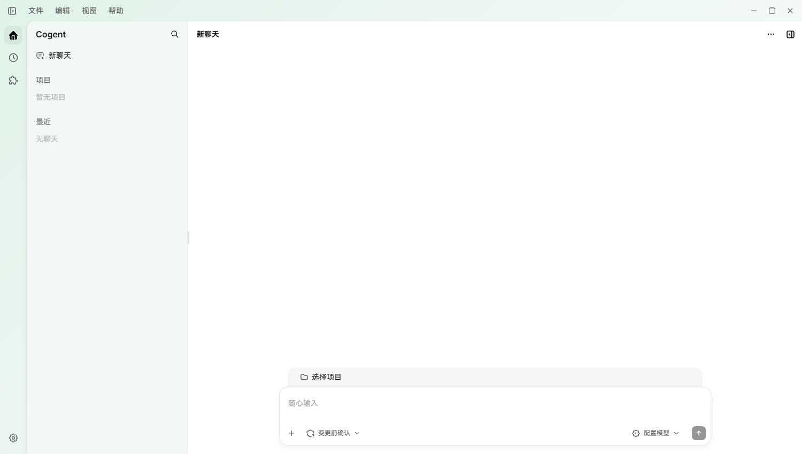

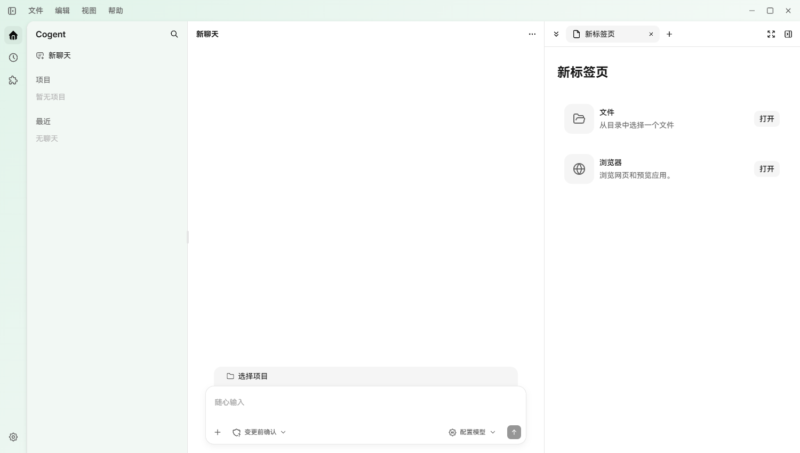

### 当前标签切换文件复验

真实产品布局278项、格式113项通过，
隔离资料、HTTP服务和自有进程均正常清理，文件/网页lease归零。

- 从本地文件切到项目Markdown，再到文本、再回Markdown，全程保持同一活动标签ID与标签数量。
  文本的真实Pierre Shadow DOM行已绘制，正文没有常驻“搜索”按钮；左侧文件搜索继续可用。
- 当前文件页内的树、搜索结果和单选本地文件共用导航路径；并行保留Markdown/PDF须先通过界面显式新建文件页。
- 模型回归覆盖A→B→C旧请求迟到、旧lease/Blob释放、旧阅读槽清空、旧视图保存不能写回新文件，
  以及目标另在其他标签时当前实例也不会被归并移走。关闭后的迟到选择不重建标签。
- 源码选区、查找结果和退出保存回归通过；Ctrl/Cmd+F按需查找仍可用。
  PDF旧Document迟到的页数夹取另有代次回归，不能改变当前文件的页码。
- 格式脚本改为显式新建并行文件页，再验证DOCX、XLSX、PPTX、PDF、Markdown、SVG与切回原标签后的查看状态。

相关回归 6 套件、46 项通过，末次回归 3 套件、20 项通过，两组有重合用例，分别计数。
lint、typecheck、build 通过。全量 `npm test -- --maxWorkers=1` 记录 151 套件通过、1,225 项通过、1 项跳过。
附件 worker 以 `0xC0000005` 退出，整轮失败，原因未确认，未执行项不计通过。
末次 PDF 代次回归在上述 20 项专项中单独复核。

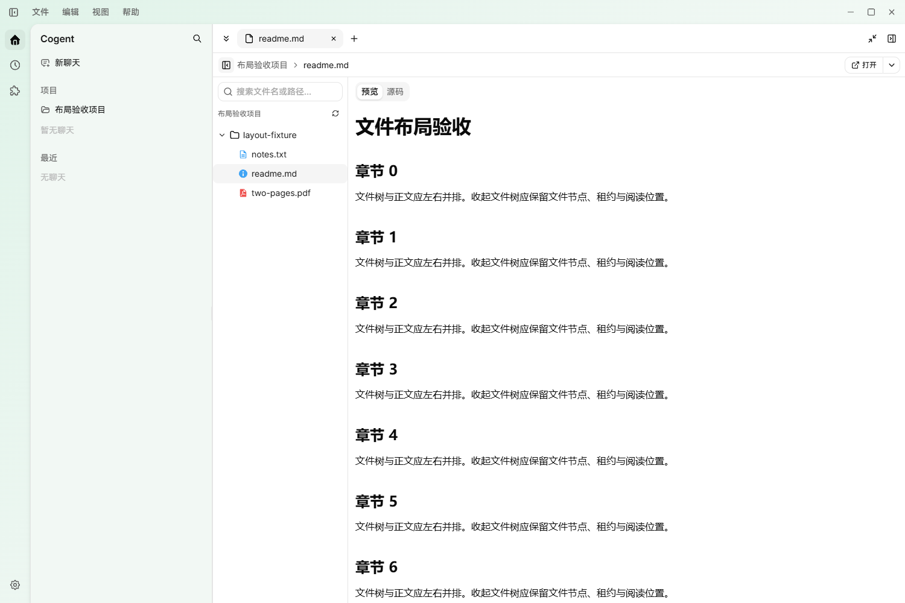

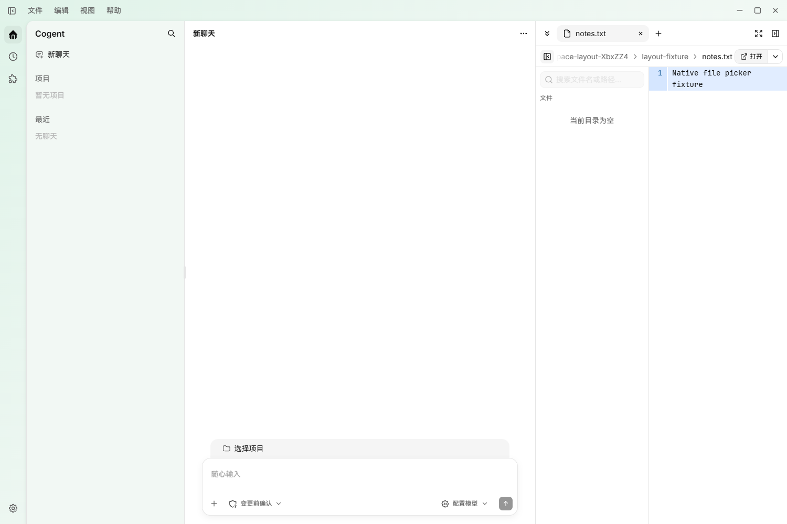

### 文件控件与边缘渐隐复验

真实Electron专项118项、布局269项通过。
专项使用480px工作区与自有PDF，布局回归仍经真实项目选择器绑定项目；隔离资料、服务与自有进程均已清理，lease归零。

- 无项目的左侧空列表仅显示“当前目录为空”，没有树头打开文件图标；顶部主“打开”仍能经原生选择独立预览文件。
- 主打开与下拉菜单实测同高28px、相邻无缝，使用现有shadcn ButtonGroup；主操作经真实lease抵达系统打开出口，
  仅测试环境拦截最终shell.openPath，避免启动外部阅读器。菜单保留打开其他本地文件与已有动作。
- PDF页码框保持36×24px，页码与总页数、总页数与下一页之间实测均为6px；263px正文内工具栏仍无横向溢出。
- 短路径无mask，长面包屑在浅/深色起点、中间、末尾分别为右侧24px、两侧24px、左侧24px渐隐。
  scrollbar-width为none、offsetHeight等于clientHeight，不挤压40px工具行；文字和按钮垂直中心一致。
- 8个实际标签制造1436px列表内容，331px视口下明暗各验证起点/中间/末尾同一渐隐规则，无可见滚动条。
  列表外的新建、占满、收起按钮不被遮罩覆盖。
- 面包屑空白停留超过共享Tooltip延迟仍无提示；完整路径提示只在实际文件名触发。
  组件回归另核对面包屑容器不再作为Tooltip触发器，原生title不回流。
- 同宽100%–300%缩放、翻页、原生页码输入和PDF真实选字继续通过；共享hook回归覆盖短内容、内容与视口改变、端点取整和清理。

静态检查、类型检查和构建通过，相关回归 7 套件、35 项通过。
全量 `npm test -- --maxWorkers=1` 记录 151 套件通过、1,222 项通过、1 项跳过。
附件 worker 以 `0xC0000005` 退出，整轮失败，未执行项不计通过。
隔离运行 `npm test -- --project integration tests/integration/attachment-worker.test.ts --maxWorkers=1`
也在 4 项中通过 3 项后以同一退出码失败，根因未确认。

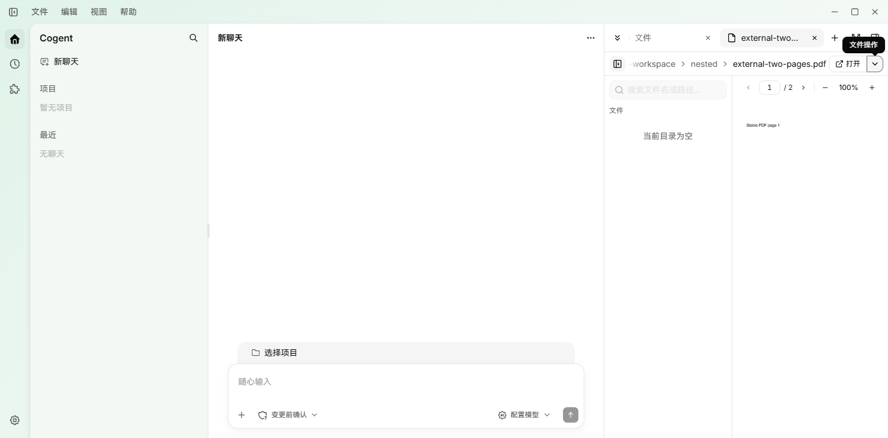

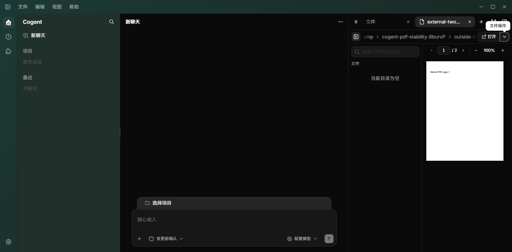

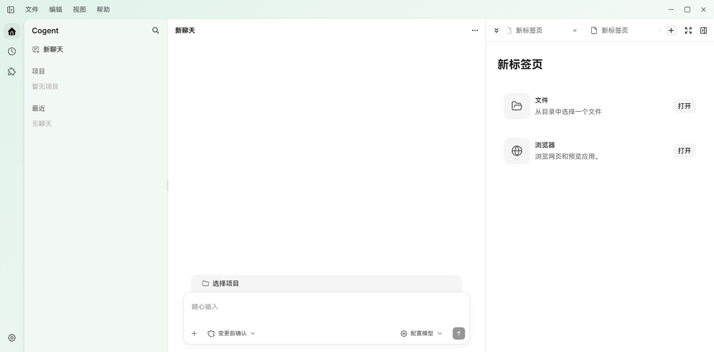

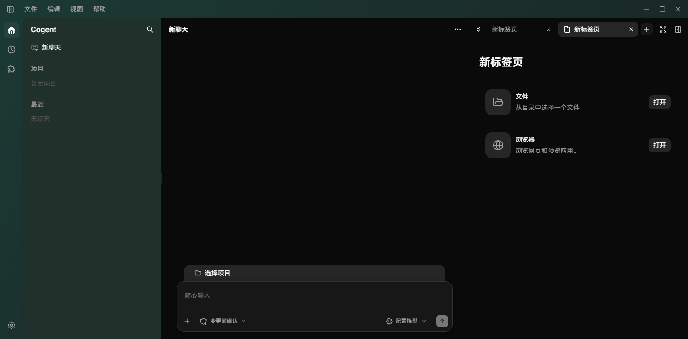

### 项目文件树与PDF缩放复验

真实产品布局266项、PDF专项101项通过。
布局脚本经真实项目选择器创建、信任并绑定隔离项目；PDF专项仅经原生文件选择打开外部文件。
两者使用独立资料、正常GPU和原生指针，退出后文件/网页lease清零，临时资料与自有进程无残留。

- 未绑定项目时文件树没有条目，搜索禁用；单独打开文件仍能预览，面包屑保留盘符到文件名的完整路径。
  长路径单行横向滚动，激活文件时定位末尾；绑定项目后只列项目根，正常搜索、关闭全部后重开仍有效。
  renderer与Host回归另覆盖外部目录grant不进入项目树/搜索，但仍可独立读取。
  最终构建的路径与缩放55项补验：480px工作区内完整文件名可见，
  能横向滚回完整盘符再回末尾，真实指针停留后共享Tooltip显示完整绝对路径；同宽100%–300%及翻页/选字继续稳定。
- PDF页码框实测36×24px，与xs图标控件同一行；图标翻页、原生页码输入和真实文字拖选通过。
- 480/560/640px工作区各扫100%–300%九档，共27组倍率；每组同一Canvas与宽度连续稳定至少1秒。
  24次放大过渡各至多新建1个Canvas、没有进入页面Loading；旧故障点560px/150%的clientWidth固定322px。
  旧构建负对照在同一故障点约1.53秒新建72个Canvas、进入73次Loading，
  视口外宽335px保持不变，clientWidth在322/335px间反跳。首次驱动有1px拖动误差，未到故障点，不计产品失败；有效负对照使用修正驱动。

文件渲染入口也改为真实绑定项目后浏览夹具，实际115项通过。
静态检查、类型检查和构建通过。首轮 `npm test -- --maxWorkers=1` 记录 150 套件通过、1,217 项通过、1 项既有跳过。
附件 worker 以 Windows 原生退出码 `0xC0000005` 退出，整轮失败，根因未确认，未执行项不计通过。
附件套件隔离运行 4 项通过。用相同命令完整复跑后，151 套件、1,221 项通过，1 项既有跳过，无未处理错误。

更广的workspace脚本通过真实项目绑定、树浏览、文件和网页保活，随后在[400px极窄窗矩阵](证据/工作区文件与PDF-极窄窗未通过.json)
发现189px面板的活动标签不能完整进入标签条；该轮create判失败、restore未运行，未放宽断言。
这是尚未完成的极窄响应式边界，按用户已确定的范围留待响应式处理，不与本轮树/PDF专项通过混写。

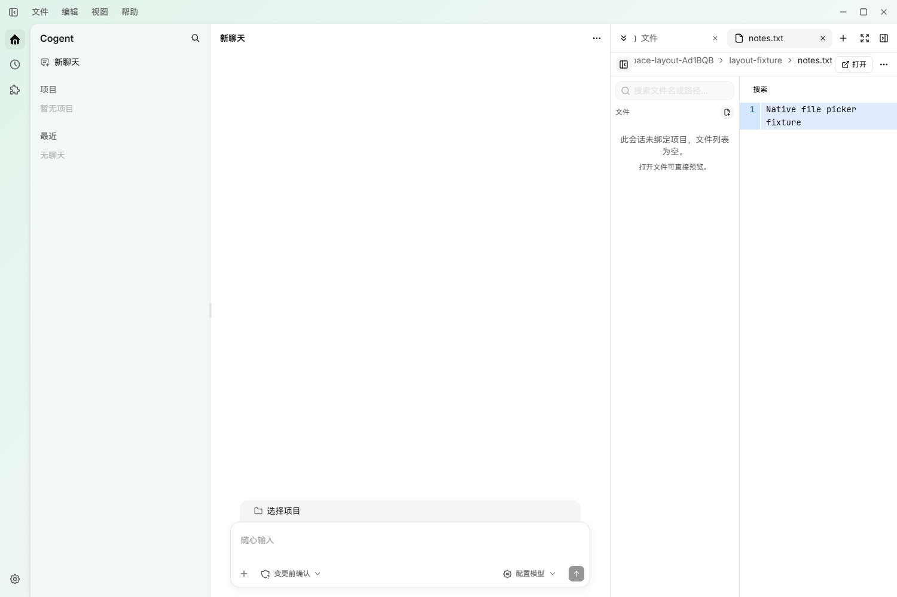

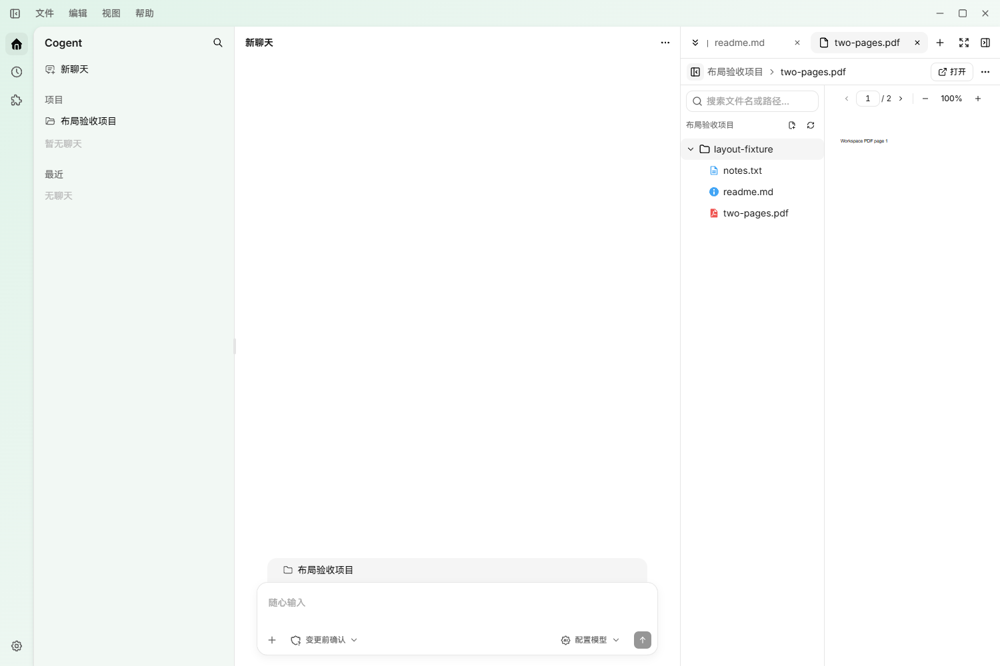

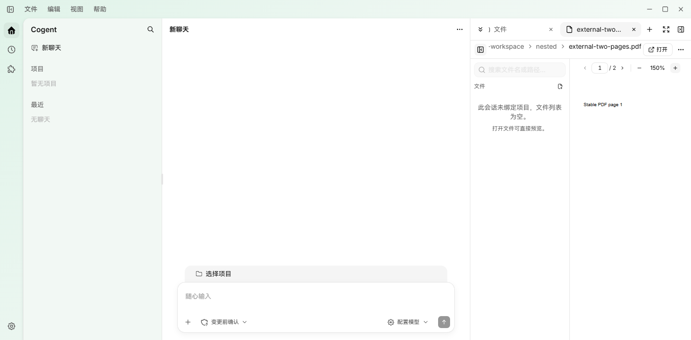

### 控件与自动收起复验

完整产品报告248项通过，原生选择器/点击/滚轮/输入均走真实产品，
资料和服务已清理，自有进程无残留，文件与网页lease/guest最终归零。

- 新标签页只有文件/浏览器两个入口；原生悬停证明标签标题、新建、树开关、PDF翻页和浏览器菜单使用共享shadcn Tooltip，
  触发器没有HTML title，提示实际显示并退场。
- 从宽窗进入760px时两侧同时隐藏，放宽恢复原开态；窄窗仍可手动展开。
  已输入的网页跨自动收起/恢复后仍是同一guest与表单；手动关闭不被放宽覆盖。
  当时Frame/store还验证自动约束不进入持久化快照；该快照机制已删除，现仅保留运行期自动约束。
- 搜索使用InputGroup的单一外边框，图标与清除操作位于框内，新增scope不继承授权。
  此前构建曾把单文件展示为“本地文件”根；该呈现已由上方项目文件树复验覆盖，旧产品报告仍作为当时的证据保留。
  来源调查核对了当前会话已保存的单文件授权和标签、新草稿的空授权；未发现自动跨scope带入的证据，未删除用户授权。
- 浏览器菜单实际256px宽、边界位于视口内，各项nowrap；缩放三钮均可原生点击并核对110%/100%/90%/100%。
- 自有两页PDF真实绘制Canvas与文字层；263px正文宽度内工具组约249px、单行居中，无横向溢出。
  图标前后翻页、原生页码输入及125%→100%适配均实际生效，页码保持；倍率以适配宽度为基准。

静态检查、类型检查和构建通过。首轮 `npm test -- --maxWorkers=4` 记录 1,211 项通过、1 项跳过。
附件 worker 以 `0xC0000005` 退出，整轮失败，未执行项不计通过。附件套件隔离运行 4 项通过。
完整复跑 `npm test -- --maxWorkers=1` 后，151 套件、1,214 项通过，1 项既有跳过，无未处理错误。
崩溃根因未确认。本批 UI 修改未涉及附件解析器、依赖或超时。

### 基础布局验收

基础布局的真实产品报告共178项检查通过，renderer无控制台错误，
文件/浏览器lease与guest最终归零，自有进程无残留，夹具服务与临时资料均已清理。
使用shadcn Tabs、Popover、Item、Breadcrumb与现有输入/菜单；新增入口仅包含已接通能力。

- 1500/850/760/680/600px逐次关闭重开均为并排；头部同高48px，无独立“返回对话”行或聊天折叠按钮。
  拖动到160px以下才折叠，双击恢复350px；占满只由按钮显式进入，恢复后继续并排。
- 新标签页纵向图标/说明/打开；文件工具行只保留树开关、面包屑和动作，下方左树右预览。
  原生滚轮结束后记录阅读位置，收起/展开树保留同一正文节点与lease；跨标签切换仍保留位置。
- 浏览器空态与工具栏位置按实际矩形核对；真实地址导航后原生表单输入、滚动与guest身份经切换/折叠重开保持。
  标签列表搜索能激活或关闭匹配项；全部关闭后无需重选目录即可重新搜索并打开文件，面包屑使用新owner快照。
- 展开入口卸载后的入焦、关闭标签后的焦点交接有DOM回归；保留活动标签语义与同级关闭钮。
  浏览器开发44项、生产38项亦通过。
- 文件渲染103项通过，包含DOCX/XLSX/PPTX/PDF真实绘制、PDF选字、Markdown公式与图表、SVG源码。
  产物文件34项及重启18项通过，交付B/原件C和文件信息入口均核对。
- 正文回归曾复现源码重开为空白：红测记录活动host正尺寸、有效lease、0代码行与无在途读取。
  真库负对照确认Pierre隐藏删除code后仍缓存原渲染范围，已补激活重绘；修后61项通过，
  包含源码重新显示、400px下1/1.25/1.5缩放保持并排、手动占满，以及真实SSE和网页表单共存。
- 最终 lint、typecheck、build 通过。`npm test -- --maxWorkers=4` 完整运行，150 套件、1,205 项通过，
  1 项既有跳过，无未处理错误。默认并发的 `npm test` 首轮有 5 项 5,000ms 超时，独立复跑有 3 项超时，
  复跑时附件 worker 还以 Windows 原生退出码 `0xC0000005` 退出。两次失败的根因均未确认。
  最终只限制并发，未放宽断言、超时或改动这些设置页用例。

驱动早期因原生滚轮方向相反、平滑滚动尚未结束、未先启用“跟随系统”而失败，
校正记录保留失败及清理结果；未通过更改产品滚动或主题行为来满足脚本。
截图等待有限动画及合成帧提交，Agent已查看新标签页、文件、浏览器、搜索浮层及明暗代表图。
下方性能表是布局调整前的受控样本，本轮未重跑流式性能对照，不能据本轮功能通过宣称原帧间隔目标达标。

### 既有模块验收

- 最终`npm run lint`、`npm run typecheck`、`npm run build`及diff空白检查通过；测试进程和独立主题/布局服务端口已清理。
- 全量133个测试文件：**1104通过、1项既有跳过**。后端覆盖独立lease、父内链hold、会话删除、renderer代次、
  迟到操作、可信根与junction、旧交付版本、冻结HTML依赖、分页/忽略/查询取消及多context关闭。
- 真实产品从未发送聊天打开10,000文件目录，不创建session；搜索未展开的文件并分别打开，
  切换保留源码滚动。Office、Markdown、图片、PDF真实绘制、音频加载及桌面文件动作保留①的回归。
- 页面输入后切文件/网页、设置往返、明暗和窗口变化，仍为同一个guest且表单不丢；
  菜单、Dialog使用真实指针命中，点击不穿透网页。
- 4档实际DPR（1/1.25/1.5/2）×5窗宽（400/760/1100/1440/1920）×明暗：
  **40种组合通过**。活动标签头保持在可见滚动范围，没有全页横溢；Agent查看了代表性截图。
  另测16px界面字号和应用zoom 1/1.25/1.5，保持布局和同guest表单。
- 旧版曾用 IndexedDB 保存并在重启恢复 100 个标签。该合同现已退役，当前关闭和重启见[仅内存复验](#标签页仅内存复验)。
- 真实beforeunload回归证明：取消后等待原生导航结束，再验证同一guest、原表单保持200ms、旧lease仍有效，
  二次确认才销毁；关闭探测期间不把原网址、标题或本地文件来源改写成空白页。
- 本地HTTP Basic挑战经真实用户名/密码界面完成；Proxy挑战、请求合并、导航取消和凭据清理有节点/组件回归。
  普通/临时profile隔离，临时历史不导出；JS对话框、SPA、查找、缩放、实际下载及终态通过原生链验证。
- 浏览器原生链100次创建/关闭没有guest残留；产品连续多轮退出检查登记的Electron/Host PID均已退出。
  ①②的完整产品驱动通过，真实本地SSE持续时可打开网页并输入，Agent完成后仍保留该guest与表单。
- 正文HTTP外链通过真实右键菜单进入内置浏览器，默认点击仍保留系统打开行为；
  Markdown相对HTML在父标签关闭后可独立网页预览。原件从页面菜单选择更大资源目录后，
  `../assets`的JS、CSS与图片真实加载；同guest保留，交付HTML没有扩大目录入口。

## 性能与容量验收门槛

这些门槛来自模块设计。已测结果见下节。时延目标按本地 SSD 和对应夹具比较，网络盘与外站另记。记录机器、OS、Electron、GPU、DPR、应用缩放和冷/热态。

| 场景 | 验收目标 |
| --- | --- |
| 应用启动 | 工作区收起且无标签。旧库删除不阻塞使用。 |
| 已驻留内容切换 | 输入到可见内容 p95 ≤ 100 ms，最大值 ≤ 250 ms。200 次切换无内容串位或状态丢失。 |
| 排序与单项关闭 | p95 ≤ 100 ms，拖动的主要帧间隔 p95 ≤ 20 ms。显著长任务超过 200 ms 时定位原因。 |
| 10,000 节点树 | 活动树 DOM ≤ 200 行。已载项的展开、滚动与筛选 p95 ≤ 100 ms，本地首批目标 ≤ 1 s。 |
| 项目文件名搜索 | 本地 10,000 文件首批 ≤ 1 s、完整扫描 ≤ 3 s。超预算明确显示暂停。 |
| 文件读取与驻留 | Host 文件读取最多 2 路，活动请求优先。可回收文件字节初值 256 MiB，解码、Canvas 和浏览器内存单独测量。 |
| PDF 与媒体 | 前台与相邻页参与绘制，隐藏音视频 ≤ 250 ms 暂停。关闭后 ≤ 1 s 停止新增绘制与调度。 |
| 浏览器容量 | 分别记录 1、5、10、20 个真实访问页的进程、内存和 CPU。默认保留用户输入。 |
| 批量关闭 | 100 个无确认阻塞的逻辑标签 UI ≤ 500 ms，受控请求、guest 和 worker ≤ 5 s 回归基线。继续下载的持有者单列计数。 |
| 循环回收 | 预热后 100 轮：应用租约、Blob、请求、监听和 observer 无残留。GC 后堆增量目标 ≤ 5 MiB，后 50 轮斜率 ≤ 0.1 MiB/轮。关闭后 RSS 增量 ≤ 64 MiB 作为诊断信号，须与资源计数和堆一起判断。 |
| 空闲及流式共存 | 静态页相对空白的单核 CPU 净增 ≤ 2%。同一流式夹具的输入 p95 ≤ 100 ms，长任务、帧间隔相较对照的增幅 ≤ 20%。 |

性能驱动预热一次、正式三次，保留 p50、p95、最大值和原始样本。正常运行与强制 GC 诊断分别采样。响应式基础矩阵为 400/760/1100/1440/1920 px × DPR 1/1.25/1.5/2 × 明暗，另记录应用缩放。原生网页浮层用真实指针命中、guest ID 和焦点恢复验证。

## 性能实测

以下是受控本机夹具的有限样本，不是所有网站或网络盘的承诺。

| 场景 | 结果与口径 |
| --- | --- |
| 200次驻留文件切换 | DPR1三次正式样本p95 **10.9 / 10.2 / 10.4ms**；各DPR样本最大p95 **21.4ms**、最大单次 **30.9ms** |
| 10,000文件树 | 活动树DOM **30–31行**；没有渲染10,000个节点 |
| 目录/搜索补测 | 10,000文件目录首批 **241.5ms**；两次搜索首批 **417.7 / 447.3ms**、完成 **418.0 / 447.6ms**，包含250ms产品防抖 |
| 单关/排序/树滚动 | 文件单关p95 **12.5ms**；30次排序p95 **19.0ms**、max **95.1ms**；30次树滚动p95 **10.7ms**；原生拖动帧间隔p95 **5.7ms** |
| 文件循环 | 10轮预热后，自然100轮和GC诊断100轮；GC后heap增量 **0.476MiB**、后50轮斜率 **0.00468MiB/轮**，每轮经过产品UI与Host读取 |
| 流式输入 | 预热1对、正式3对，工作区正式输入p95 **26.4 / 29.2 / 31.1ms**，8场景均无超过50ms的长任务 |
| 流式帧间隔目标未达 | baseline p95 **11.3 / 16.6 / 11.2ms**，工作区 **16.7 / 16.7 / 22.2ms**；两组增幅超过 20%，输入延迟通过，帧间隔目标未达。[正式对照](证据/多标签工作区流式对照.json) |
| 初版批量关闭 | 逐页提交曾实测约2341ms，未达到目标；已改为不需确认标签合并提交 |
| 修后全部关闭 | 最终完整产品复验100个逻辑标签、包含一个网页，真实菜单命令至收起/guest消失 **246.0ms**；随后重新授权打开本地文件通过 |
| 浏览器驻留 | 1/5/10/20页private bytes合计约 **386 / 489 / 628 / 925 MiB**，分别预热并采三次 |
| 静态页CPU | 上述各档三次Electron进程CPU样本最大约 **0.28%**；不含独立Host进程，不外推动态网页 |

容量探针working set合计约578/988/1485/2495 MiB，跨进程共享页会重复计数，**不能当作独占RSS**。
文件原始字节缓存256MiB、最多8个重文件查看器属于可回收预算；浏览器默认不自动丢弃表单，
提供显式休眠。没有用强制GC结果冒充正常驻留。

循环诊断保留一个alpha文件作为基线，各GC采样fileViews租约均为1、在途请求0，DOM均为678节点/319监听；
自然运行和 GC 诊断分开采样。计数来自主 renderer CDP 与 fileViews IPC，Host 内部资源另需核验。
独立诊断只覆盖其明确列出的循环与交互，不代替完整产品设置往返、矩阵和重启验证。

追加的[有界定位样本](证据/多标签工作区流式定位.json)中，静止 rAF 的 p95 均约 5.6–5.7ms，未观察到固定 60Hz 上限。
该对流式帧p95为baseline 22.2ms、工作区16.8ms，且工作区的Script/Layout/Style累计开销更低。
这不能抵销正式三对中的失败，也不足以归因GPU、合成器或某个工作区热点。
采样在120次真实输入后结束，恒速SSE在不同持续时间累计的正文量不同，限制了相对帧差异的因果解释。

## 已发现并修复的问题

真实测试先后发现并修复：Headless Tree重建与过期虚拟下标、父/子lease释放竞态、草稿目录owner迁移、
跨域代次比较、renderer刷新后旧资源残留、关闭取消仍删除session、批量关闭逐页渲染、暗色透明网页黑底、
标签头缩窗后不可见、浏览器attach前接受导航，以及原生history.restore在webview提交bootstrap后必然失败。

开发模式曾稳定停在“浏览器正在准备”：StrictMode两次effect的reserve复用同一lease，旧effect迟到release撤销新guest。
旧main真实故障记录相同的两份lease、新guest已attach后的旧release及地址栏持续disabled。
每次初始化独立分配lease；启动/附加15秒超时明确报错，初始化失败“重试”重建lease与guest。
开发44项与生产38项通过，
含真实StrictMode的迟到回复、首次attach故障注入后点击重试、地址栏导航与原生输入；关闭后lease/guest均0。
开发服务仅启动renderer，随机端口/缓存/资料全部隔离；清理汇总确认自有进程及服务退出。
生产构建没有StrictMode双effect行为，因此只有生产验收不足以覆盖此回归；不移除StrictMode来规避问题。
此修复的 lint、typecheck 和 build 均通过。`npm test -- --no-cache` 全量运行，145 套件、1,185 项通过，1 项既有跳过。

浏览器专项末次复跑曾因隔离用户目录下`app.getPath('downloads')`抛错而下载超时，
并出现主进程原生错误弹窗；已让保存对话框直接使用文件名，避免依赖可用的系统下载目录，
新增目录不可用回归。修后真实点击下载保存的17字节与夹具一致，专项正常退出、进程无残留。
隔离测试显式设置独立下载目录，驱动异常写入失败报告并结束，不留下阻塞用户桌面的错误弹窗。

真实关闭专项发现Electron40的webview直接close忽略原生取消，曾在返回`closed:false`后约4ms销毁guest。
已改为公开导航 API 协商，等待取消的 `ERR_ABORTED` 或空白页实际提交，再决定是否销毁。修后原表单保持 200ms，第二次确认才销毁。
官方源码原因与参照差异归[技术笔记](../技术笔记/内置浏览器与聚合面板.md#关闭确认为什么先走导航)，不只以mock事件认定保留成功。

补测驱动早期曾因原生全选尚未生效就插入文本、点击隐藏的文件导航或在标签滚动完成前取坐标而失败；
失败日志与后续独立attempt分开保留，未把部分测量写成完整通过。驱动等待实际选区/可见性/命中与几何稳定，
循环诊断用独立出口报告；设置焦点与流式另跑完整场景。
拖动后紧接的点击还受到dnd-kit松手后50ms的capture click抑制；驱动等待手势结束，
并断言真正选中的标签。设置期间标签头按设计卸载，回首页后要求恢复同一选中网页与表单。
首轮全量另有设置下拉框用例同步读取选项失败；已用受控动画帧确认Base UI实际在下一帧展开，
仅为该测试补真实ARIA/listbox开关状态等待，保留原选项、保存和重读断言，未改产品或增加超时；最终全量通过。

焦点补测中的[异常样本](证据/多标签工作区异常样本.json)记录 200 次切换 p95 为 18.2ms、最大间隔 8369.4ms，随后界面步骤失败。
该样本未并入性能通过批，原因尚未确认。

运行期浏览器历史使用公开URL/标题栈：首次仅加载选中地址，工具条回访重新导航，不声称恢复旧POST、JS history或表单内存。
主题几何夹具的图片改为本地HTTP绝对URL，避免把没有FileLinkScope的相对测试资产当成桌面文件。
旧流式回归曾在主动renderer重载前请求工作区flush并等事务确认；该保存/水合流程已删除，
旧脚本的这段断言不适用于当前契约。当前renderer重载与进程重启均从空工作区开始。

## 系统浏览器交接与站点权限

Windows默认浏览器为Edge时，在内置浏览器打开[百度热榜搜索地址](https://www.baidu.com/s?wd=%E4%B8%89%E4%B8%AA%E6%97%B6%E9%97%B4%E5%9D%90%E6%A0%87+%E8%AF%BB%E6%87%82APEC%E2%80%9C%E4%B8%AD%E5%9B%BD%E5%B9%B4%E2%80%9D&sa=fyb_n_homepage&rsv_dl=fyb_n_homepage&from=super&cl=3&tn=baidutop10&fr=top1000&rsv_idx=2&hisfilter=1)，
从更多菜单点“系统浏览器打开”；系统页面应保留相同搜索词及其他参数，仅少`tn=baidutop10`，内置地址和历史仍保留该标记。
百度首页入口也应正常打开；其他默认浏览器应收到完整原URL，此分支由源码单测覆盖，未代称其他浏览器实机验证。

更多菜单进入站点权限，展开小号Select：下拉层在触发框下方约4px、右边缘对齐，与触发框等宽，不覆盖选中值。
选择麦克风“拒绝”只提交音频权限，摄像头保持原值；修改后仍由main重新加载站点以结束旧采集。

Edge158独立配置的原URL、固定标记、Unicode及引号对照，产品真实main/preload/renderer的交接回归，
以及用户对系统页面的确认，见[地址参数证据](证据/系统浏览器打开-地址参数对照.json)。
独立无头配置触发的百度安全验证只证明已经开始站点导航，不计为搜索内容验收通过，也未绕过验证。
源码相关回归59项通过；lint、typecheck与build通过，全量163个测试文件通过，1363项通过、1项既有跳过。

## 验证边界

各格式按Zcode可视化库对齐后的真实文件绘制、选字及补丁验证见[文件预览渲染验收](文件预览渲染.md)。

未运行物理摄像头/麦克风、系统原生上传选择器、外站SSO/真实代理、网络盘、Linux/macOS、物理IME和显示器DPI认证。
标准文件上传由Chromium原生能力承载；未把输入元素存在冒称为操作过系统选择器。
流式帧间隔相对增幅未全部达到20%目标，详见实测及独立失败报告；100次guest销毁及进程退出不等同Host内部资源全量清点。
不支持的USB/蓝牙/串口/屏幕源权限在界面明确说明并拒绝。不存在需要用户替Agent执行的本批核心手测步骤。

## 实际界面

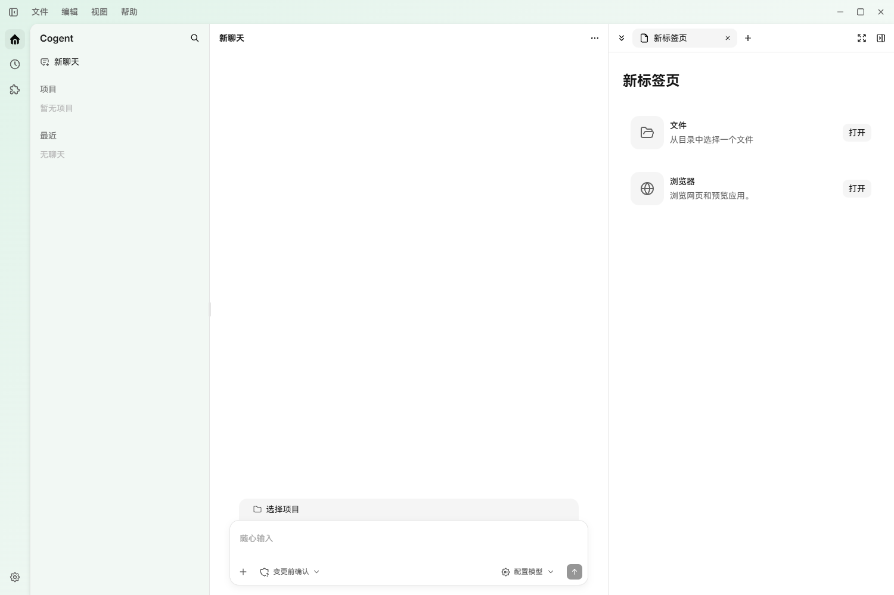

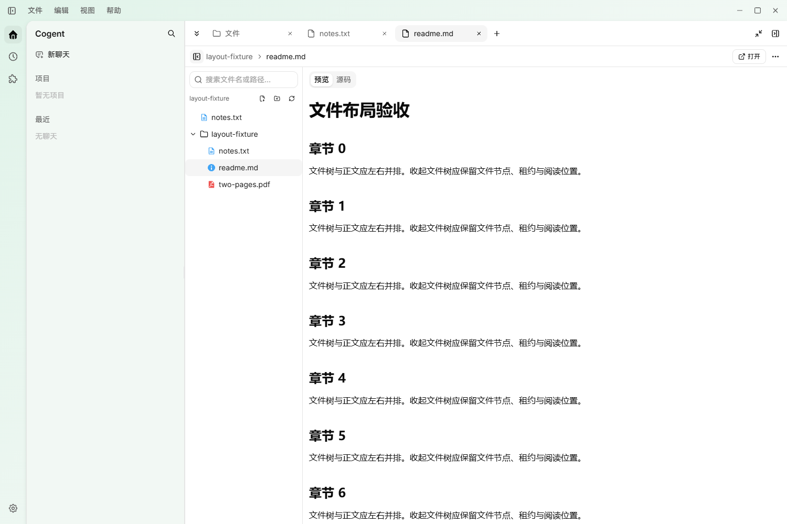

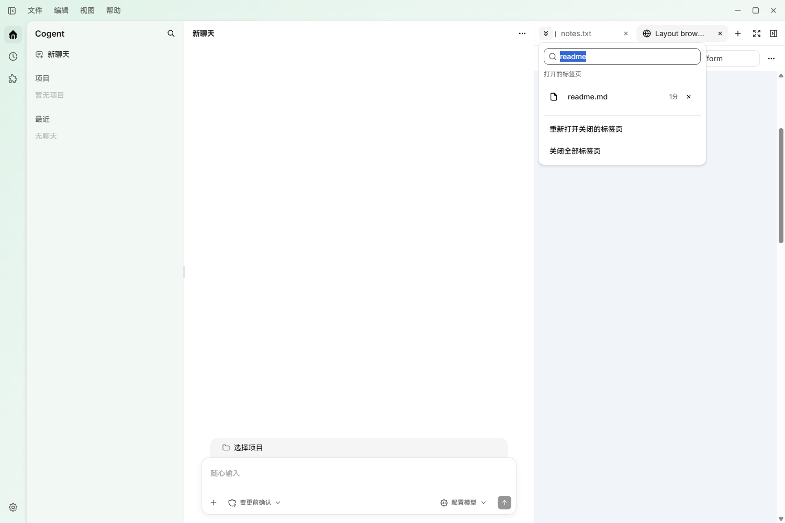

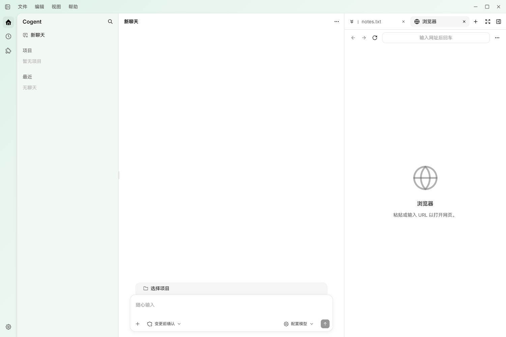

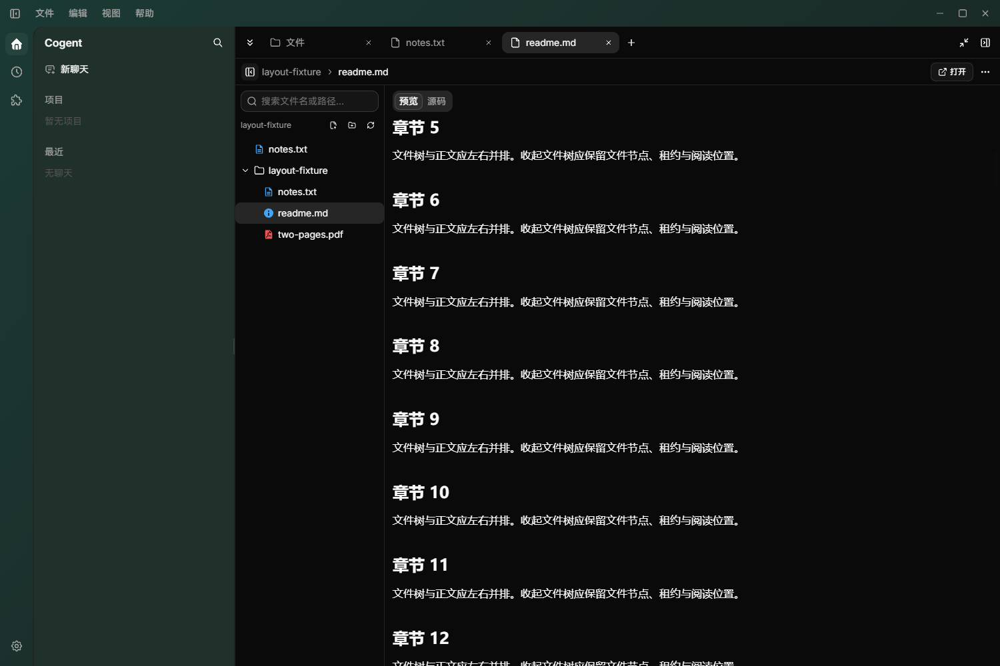

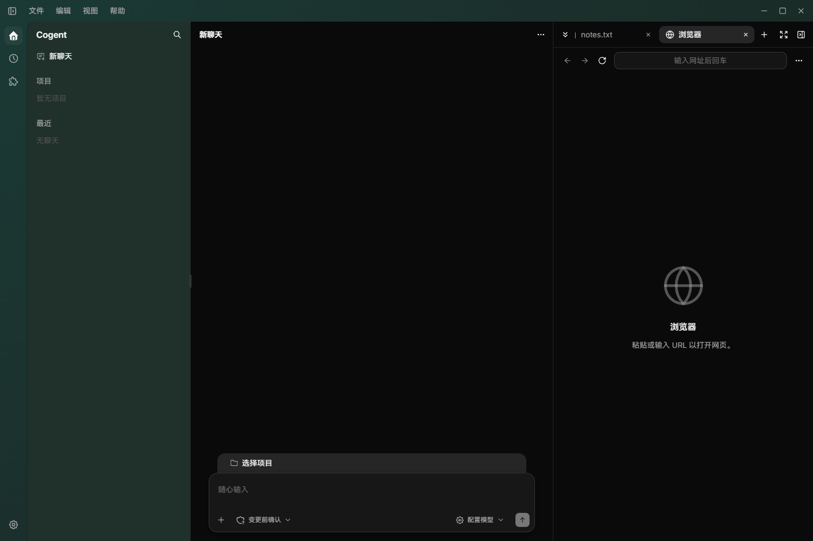

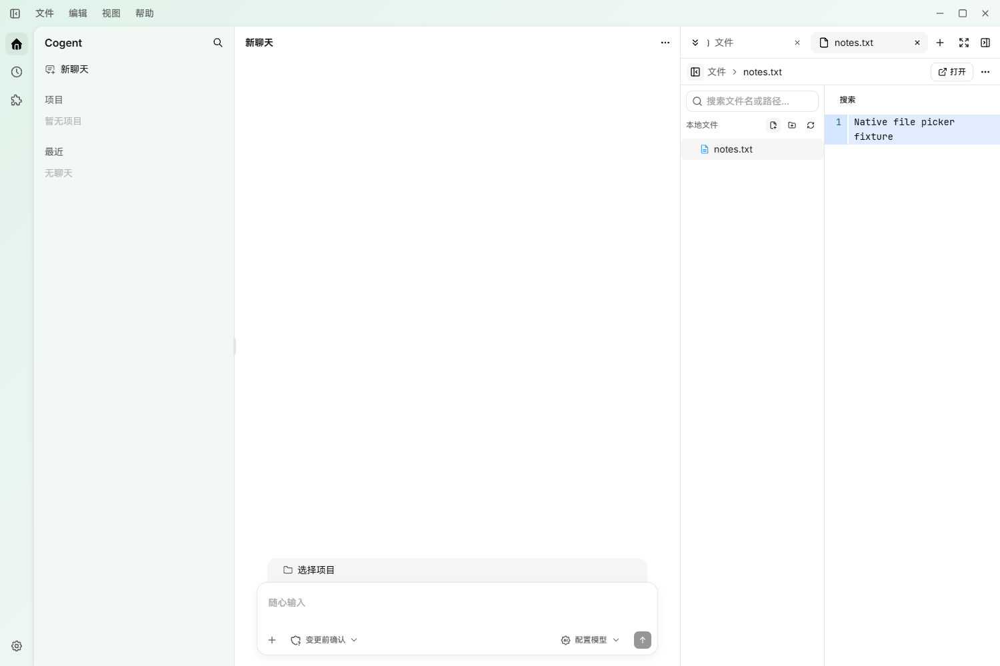

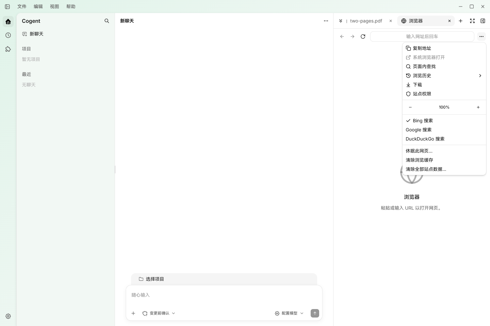

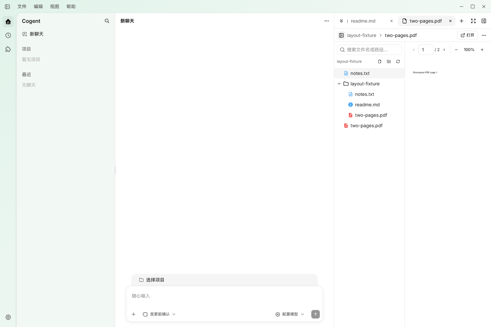

