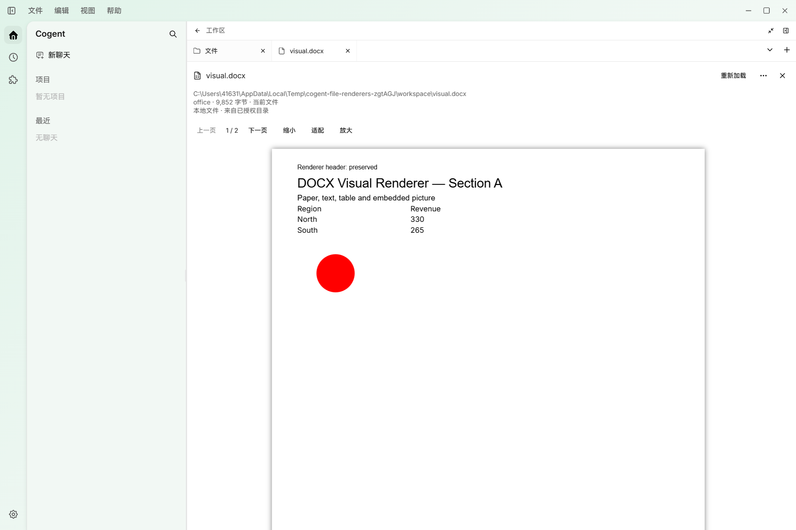
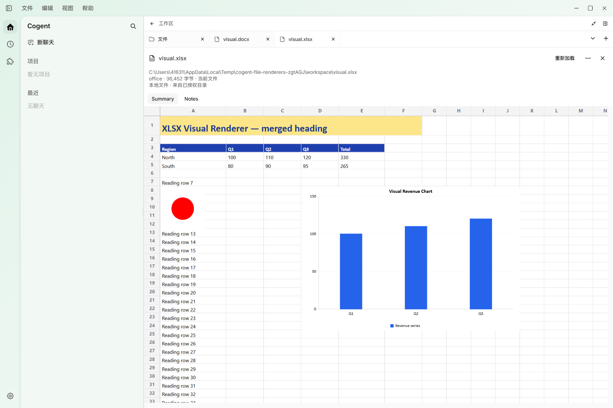
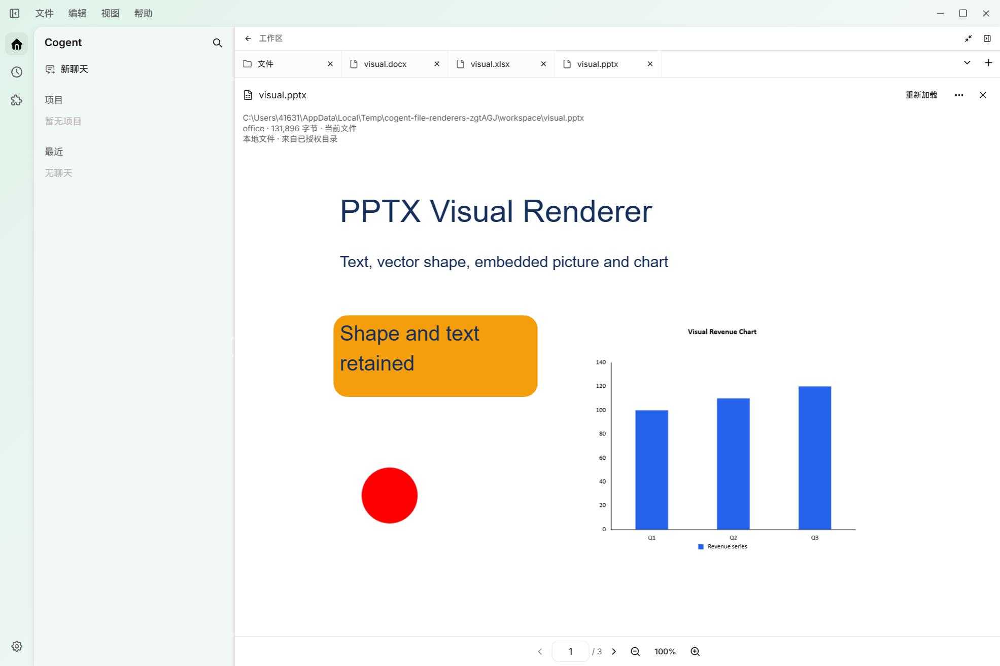
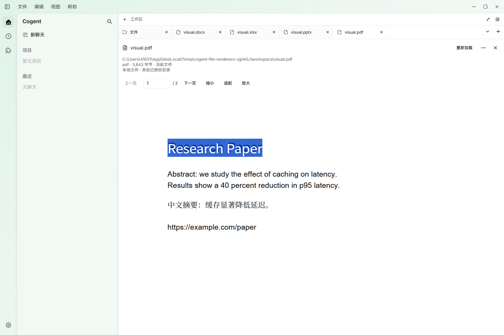

# 文件预览渲染验收

机制见[模块](../模块/文件预览渲染.md)，三仓出处与取舍见[技术笔记](../技术笔记/文件预览渲染.md)。
测试使用Windows、Electron40.9.3、Chromium144、正常GPU；隔离profile/COGENT_HOME/工作目录，无用户凭据和付费模型。

## 自主复现

```powershell
npm run build
node scripts/check-file-renderers-electron.mjs
node scripts/check-pdf-stability-electron.mjs
node scripts/check-preview-patches.mjs
node scripts/check-file-links-electron.mjs
node scripts/check-workspace-electron.mjs
```

涉及窗口焦点的脚本串行运行，各自正常退出；测试不从store注入文件内容。
Office合成原件、参考样本来源与SHA256见[夹具清单](证据/文件预览渲染-夹具来源.json)，原始字节由真实导航→main授权→Host租约读取。
`--fixtures-only`只生成夹具，不代表产品链已经验证。

## 实测结果

PDF滚动条阈值的旧构建负对照与修后27组倍率稳定采样、36×24px页码及真实选字见
[工作区专项](多标签工作区.md#项目文件树与pdf缩放复验)；文件渲染项目入口复验115项通过，保持真实项目树→Host读取链。

完整 `npm test -- --no-cache` 独立复跑，145 套件、1,175 项通过，1 项既有跳过，无未处理错误。
`npm run lint`、`npm run typecheck`、`npm run build`均通过；构建含本地WASM/PDF资源和渲染依赖版权文本。

| 范围 | 验证行为 | 结果 |
| --- | --- | --- |
| Office/PDF/Markdown/SVG | 完整产品绘制，含 SVG 实际多色 XML token | 104 项通过 |
| DOCX | 双section36pt/72pt页边距、纸张、页眉页脚、表格、包内图片、第二页导航 | 真DOM与图片完成解码，截图复核 |
| XLSX | WASM读取、双表、合并填充/表头颜色/图片像素、实际SVG图表、sheet恢复 | 真Canvas绘制；明暗切换及设置往返后重绘 |
| PPTX | 多页文字/矢量形状/图片/ECharts图表、第二页导航、隐藏释放页面 | 真Canvas/DOM；非抽取文字 |
| PDF | Canvas、文字层、真实鼠标拖选Research Paper、第二页文本 | 实际选区全文匹配；离线资源无加载错误 |
| Markdown/SVG | KaTeX公式、Mermaid SVG、SVG img预览/可见源码往返 | 实际图形可见；源码由Pierre Shadow DOM渲染 |
| 资源 | 空白对话未暗建session，全部关闭卸载查看器 | lease/在途操作0；自有进程全部退出，无强制结束 |
| 依赖补丁 | PPTX tooltip 转义、XLSX ESM/CJS 回调、内部跳转、双声明及逆向重放 | 28 项通过 |
| 正文与浏览器共存 | read引用/历史水合、5种定位、本地图片、Office、WAV、窄窗、持续SSE时网页表单 | 51项回归通过，renderer错误列表为空 |
| 工作区/浏览器 | 设置往返、1500 行文件滚动恢复、beforeunload 取消及确认 | 历史完整产品创建 107 项、原生关闭确认 12 阶段通过。旧持久化合同已退役，见[仅内存复验](多标签工作区.md#标签页仅内存复验) |
| 产物副本 | 交付 B / 原件 C、另存、Markdown 同清单依赖、删除原件后重启仍读副本 | 首轮 30 项、重启 14 项通过，renderer 错误列表为空 |

补丁测试实际执行安装包中的formatter、回调和ViewerInner，声明通过真实.mts/.cts调用者编译；
未补丁负对照确实生成危险img/onerror节点。临时副本逆向/重放匹配补丁Git blob，当前安装包只存在LF/CRLF差异，
测试没有修改活动node_modules，不把源码字符串匹配当执行证据。

## 失败与修复证据

PDF 真实鼠标选字最初失败，命中文字 span 的 computed `user-select` 为 `none`。
查看器放开内容区选择后，真实拖选取得 `Research Paper`。
PDF排版尚未完成或超像素预算时的夹零滚动、卸载ref清空后的最后滚动保存、缓存图片早期load/error覆盖均有行为单测。

驱动首轮误用DOM img检查被Canvas烘焙的表格图片，改为已知红色像素与真实图表几何；
主题控件必须先进入设置→外观，不能从工作区直接找。截图需等路由显隐重绘和合成帧提交，
避免把首帧空surface或仍在过渡的标签指示器当作稳定效果。原attempt保留在`tmp/file-renderers-attempt-*`。
旧正文脚本迁移Shadow DOM时也曾出现嵌套转义错误，失败记录保留于`tmp/file-links-zcode-renderers`，修后独立复跑通过。
产物脚本同样改读Shadow DOM实际可见行，保留原交付版本和原件操作的全部断言。

一次全量 `npm test -- --no-cache` 中，`attachment-worker.test.ts` 的 Vitest worker 以 Windows 原生退出码
`0xC0000005` 退出。其余 144 套件、1,173 项通过，1 项跳过，整轮失败，根因未确认。
同套件独立运行 3 轮各 4/4 通过，未复现原生故障。另一次运行在 global setup 构建遇到 `EPERM`，未进入测试。

## 边界

没有确认真实旧OLE `.doc/.xls` 的解码效果，也不把同名入口或DOCX伪装扩展名当旧格式支持证据。
合成样本不代表所有Office高级对象/字体都与桌面Office逐像素一致；第三方库能力边界保留明确错误。
本批不宣称解决外层布局问题；既有流式相对帧间隔未达目标的失败仍见[工作区记录](多标签工作区.md)，没有更改门槛。

## 实际内容








