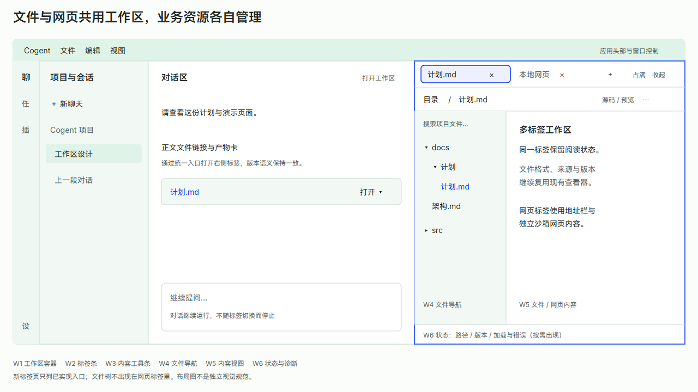
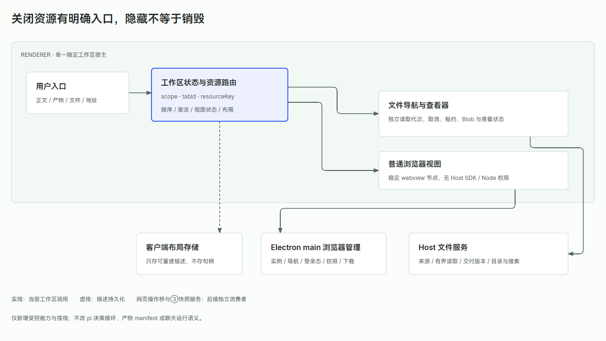

# 多标签工作区实现

> 2026-11-21实施更新：本稿保留设计与目标；已落实的合同见[模块](../模块/多标签工作区.md)，
> 实际通过项、性能样本与未运行环境见[验收](../测试用例/多标签工作区.md)。
> P5继续按原门槛记录：正式流式输入p95通过、相对帧间隔增幅有两组超过20%；
> 单次有界定位未确认工作区单向热点，不能用该次结果抵销正式失败，也不把180Hz静止cadence称作流式达标。
> 功能、关闭原生回归与Windows完整产品复验的通过项及全量测试异常以[最新验收](../测试用例/多标签工作区.md)为准。
> 本稿仍保留相对帧指标这一验收余项，未标为P5全通过；不提前进入③。
> 工作区状态只在运行期内存保留，应用重启默认收起且无标签；旧工作区库在启动时异步删除，不读取内容。
> 实际宿主为常驻绝对定位面板与对话padding留位，保留同一内容父节点。

> 本文保留详细设计与原验收目标，当前实现和实测以顶部实施更新链接为准。用户已确定：先完成独立的多标签工作区，再做文件路线图③。
> 设计、实现、测试由 Agent 自主推进；常规验收以隔离自动化与实测证据完成，不转交用户手测。
> 本稿包含标签、文件导航/查看和普通内置浏览器；Agent 操作网页与③快照另行接入。
> 原理与来源：[内置浏览器与聚合面板](../技术笔记/内置浏览器与聚合面板.md)。
> 未绑定项目的真实默认目录尚未实现，按用户决定暂缓；调研与后续建议见[默认会话工作目录](默认会话工作目录.md)。

## 1. 交付目标与完成定义

本模块是独立工作面，不是聊天里的临时预览弹窗。用户能并行打开多个文件和网页，
切换/收起/放大后接续原位置；空白新对话也能浏览本地文件；应用重启收起且无标签，浏览器登录态独立保留。
①②已有的文件来源、交付副本、预览格式与桌面动作继续复用，③在本模块整体完成后再进入。

| 本次完整交付 | 完成效果 |
| --- | --- |
| 标签工作区 | 新页、切换、去重、排序、溢出、批量关闭、运行期最近关闭恢复、分栏/占满/窄窗 |
| 文件导航 | 绑定项目的目录分页、刷新、文件名/相对路径搜索、键盘导航；外部文件单独预览，不扩充项目树 |
| 文件查看 | 复用源码/Markdown/图片/PDF/Office/音视频；运行期按标签保留查看状态与版本 |
| 普通浏览器 | 地址/搜索、历史、多网页、登录、上传/下载、站点权限、localhost、本地 HTML |
| 独立生命周期 | 首页切设置后仍保有工作区；后台不挡前台，关闭可靠清理；重启收起且无标签 |
| 自动验收 | 四关、完整产品 Electron、布局/焦点/异常/容量/性能、清理证据由 Agent 执行 |

内部按批次实现，但中途的「标签已画出、文件/网页入口仍空」不算完整模块完成。
不承诺任意站点的 DRM/付费视频/第三方 SSO 均等同完整 Chrome；失败须保留真实原因与外部打开。

## 2. UI 结构与视觉

### 2.1 主界面与区域

[打开完整图示](../img/多标签工作区设计.html)；以下 PNG 均从同一 HTML 导出。
图是区域/行为结构稿，产品使用项目 Nova 原生组件与统一字号，不照搬示意框的皮肤。



| 区域 | 放什么 | 交互约定 |
| --- | --- | --- |
| W1 工作区宿主 | 位于 content-main，启动收起且无标签，首次显式打开后出现 | 打开文件/网页可展开；启动不自动显示入口Tooltip；不改左侧项目与会话语义 |
| W2 标签条 | 类型图标、标题、关闭、＋、溢出列表、占满/返回、收起 | 标题截断/Tooltip 全文；只在标签条横向滚动；当前标签始终可见 |
| W3 内容工具条 | 文件路径/目录开关/展示与动作；网页地址/导航/菜单 | 随当前内容类型变化；操作少时不强占第二行 |
| W4 文件导航 | 会话绑定的项目根、搜索与刷新 | 未绑定项目为空；外部文件只在预览与完整路径面包屑呈现 |
| W5 内容区 | 新标签启动器、文件查看器、沙箱网页或可恢复错误页 | 一次只显示一个前台内容，不全量绘制后台文件 |
| W6 状态反馈 | 加载、来源/版本异常、目录尚未完整、下载与权限请求 | 正常态简洁；不把内部 token/fileId/实现细节放到产品文本 |

新标签页只列「文件」「浏览器」两个可用入口；运行期关闭历史从标签列表或快捷键恢复。
进入功能替换当前空新页；从正文/卡片打开资源仍走统一路由。
文件页的目录可展开/收起；目录行单击展开，文件行单击打开或激活对应文件标签。
多个文件页共享一棵当前项目目录树与展开偏好，各自拥有阅读状态；树可手动收起。

### 2.2 手动布局与尺寸合同

```text
分栏                                    手动占满
┌────────对话────────┬────标签与控制────┐  ┌────────标签与控制─────────┐
│                    │ 文件/网页/新页  │  │ 文件/网页/新页           │
│                    │                │  │                          │
└────────────────────┴────────────────┘  └──────────────────────────┘
拖动工作区小于160px → 收起；聊天右上角显示展开入口
```

- 分栏：任何窗口宽度都可打开；默认350px，对话保留160px，当前显示宽度限制在剩余可用空间。
  不按断点自动占满或禁用展开；≤760px与会话侧栏同步临时收起，放宽恢复手动开态，收起后仍可显式展开。
  完整响应式策略另行设计。
- 占满：工作区占 content-main，保留应用头部/窗口控制与应用导航；一键回原分栏。
  占满不是新建窗口，也不停止对话。
- 折叠：拖动工作区小于160px时关闭；新建、切换、关闭、占满和收起始终从同一标签行操作。
  标签行与对话头部同高；展开时隐藏对话头部的工作区按钮，收起后恢复展开入口。
- 尺寸以 CSS px 为准，按用户手势提交到内存；窗口/字体/缩放自动约束不回写成新的运行期偏好。
  默认350px、拖窄160px门槛和对话160px留位分别约束偏好、手势与当前几何，不能相互替代。

同一 WorkspaceSurfaceRoot 始终挂在 AppShell 的稳定父层级；分栏槽与占满只改其几何。
HomeMain 提供布局槽位，不再在右栏与 Dialog 两处分别创建 FilePanel。
原生网页节点不因拖动标签头、切聊天、响应式或一级导航换 key/换父节点。
标签头顺序与内容挂载顺序分开：内容按稳定创建顺序呈现，不因重排 tabs 数组移动 guest DOM。
Root 不是 portal 进可被销毁的 HomeMain 槽；它固定在 AppShell content-main wrapper，
用槽位几何定位，左栏动画/缩放期间持续跟随真实矩形，不只量动画第一帧。

### 2.3 键盘、焦点与浮层

Base UI 管 tablist/tabpanel 的 ARIA 与方向键；关闭按钮不能嵌在 button 类型标签按钮内。
标签菜单提供「左移/右移」，键盘排序不与方向键激活、Space/Enter 争用。
工作区焦点内 Ctrl+T 新页、Ctrl+W 关标签、Ctrl+Tab 切换；网页焦点内 Ctrl+L、Alt+左右、
Ctrl+R 与地址/导航一致，由 guest 的 before-input-event 转交明确命令，不误关整个应用。
输入控件的编辑快捷键和网页自有快捷键按焦点/修饰键分流，不注册应用级 globalShortcut。

关闭/收起后焦点回触发入口或对话输入，不跳页面滚动。Esc 先关顶层子菜单/弹窗，再收起已占满的工作区。
隐藏内容 inert 且不收快捷键；网页失去前台时 main 同步交还原生焦点，不能只靠 DOM inert。
Dialog/Popover/菜单/Tooltip 沿公共组件；新增工作区布局变体在 components/ui 本体维护，
不在调用点拼皮肤。P0 验证 keepMounted、固定 portal 容器与 Base UI 焦点恢复；
不用「切页全部关浮层」冒充保留，也不扩大改造全部设置页面。
Base UI keepMounted 会保节点但仍使用 hidden/inert，通常产生 display:none；载体探针只测
visibility。P0 必须用真实 TabsContent 的隐藏路径重测 guest ID/输入/滚动，不在调用处
覆盖库隐藏语义来掩盖失败；若需不同承载，在稳定宿主层调整并保留 ARIA 合同。

## 3. 功能清单与可观察行为

| 编号 | 功能 | 用户能观察到的结果 |
| --- | --- | --- |
| F01 | 标签创建/激活 | 功能替换新页；点击已有文件聚焦并更新定位；网页同 URL 可开多份 |
| F02 | 排序/溢出 | 拖动仅重排标签头；拖完保持内容身份；长列表有滚动/列表选择与键盘等价操作 |
| F03 | 关闭 | 关当前选相邻，关后台不跳；关其他/全部按开始时选中的 ID 集合，不误关后来新建项 |
| F04 | 最近关闭 | Ctrl+Shift+T/菜单恢复本次运行最近关闭描述，最多 20 项；网页创建新实例，不复活旧 lease |
| F05 | 空工作区 | 关最后一页收起；用户重新展开才补新页，Ctrl+W 能关完 |
| F06 | 文件来源 | 原件与交付副本清楚区分；旧消息仍用原来源，source-only 不虚构历史副本 |
| F07 | 多根/独立打开 | 项目根并列；可选项目外文件/目录；未发对话可用且不暗建聊天、不导入为附件 |
| F08 | 目录浏览 | 懒展开/分页/取消/刷新；空、失败、消失与未加载完分清；同名根不混 |
| F09 | 项目搜索 | 搜索文件名/相对路径，涵盖未展开目录；流式结果/取消/继续扫描/范围与忽略项明确 |
| F10 | 文件查看状态 | 本次运行内源码滚动/搜索/选区、Markdown 模式、图片缩放、PDF 页码、Office 工作表、媒体时间可接续 |
| F11 | 文件动作 | 保留复制、系统打开、定位、另存、编辑器；HTML 另有显式「网页预览」 |
| F12 | 网页导航 | 地址归一化、网页搜索、前后退、刷新/停止、标题/favicon、错误重试、系统浏览器打开 |
| F13 | 网页状态 | 切标签/布局/聊天/设置仍是同一已访问页面；输入、滚动与登录态保留 |
| F14 | 网页交互 | target blank/window.open 路由标签；登录、标准上传、JS 对话框、页面查找/缩放可用 |
| F15 | 权限/下载 | 站点请求可允许/拒绝/撤回；下载可选择位置、看进度、取消、打开与定位 |
| F16 | localhost/HTML | 开发服务可预览；本地 HTML 可连带受管目录内 CSS/JS/图片执行，不获得 Host SDK |
| F17 | 启动/异常 | 应用重启收起且无标签、关闭历史或阅读状态；Chromium 登录态独立保留；单网页崩溃只影响本标签 |
| F18 | 与聊天共存 | 流式/审批/提问继续；切内容不重建会话，不触碰产物 manifest 与③快照 |

## 4. 技术栈与复用选择

| 层 | 选型 | 为什么 / 我们仍要做什么 |
| --- | --- | --- |
| UI | 现有 React 19、TypeScript、Tailwind、shadcn Nova / Base UI | 沿项目组件与字号；不是重做设计系统 |
| 标签 | 现有 Tabs + 窄工作区模型 | Base UI Panel 使用 keepMounted；不照搬 Radix forceMount/data-state |
| 排序 | @dnd-kit/core 6.3.1、sortable 10.0.0、utilities 3.2.2 | 锁同一成熟接口；只拖标签头，不拖内容父树；不混用新版 API |
| 分栏 | 现有 react-resizable-panels 4.18.1 / GlowResizeHandle | 复用真实拖动/折叠；不引 dockview/FlexLayout 等任意窗口布局框架 |
| 文件树 | @headless-tree/core、react 1.8.0 | 复用 ARIA、焦点、键盘与树状态；Nova 行与业务数据仍归本项目 |
| 树虚拟化 | @tanstack/react-virtual 3.14.26 | 只渲染视口+overscan；不能替代磁盘分页/搜索 |
| 状态 | 现有 Zustand + 资源 owner | 布局、查看状态、文件任务、网页实例分开，工作区状态仅在内存保留；不用第二套服务容器 |
| 文件查看 | 格式库及生命周期由[文件预览渲染](../模块/文件预览渲染.md)统一描述 | 保留有界读取与来源安全，阅读状态归每标签 |
| 目录/搜索 | Host 新增异步枚举/嵌套规则服务，复用已依赖的 ignore 包；桌面上下文接口 | 当前没有通用扫描服务；取消/游标/预算归 Host，不灌全项目索引 |
| 普通网页 | Electron 40.9.3 的稳定 webview + main BrowserTabRuntime | 同 DOM 浮层合成；无第二 Chromium/Python，不提前 attach CDP |
| 存储边界 | 工作区内存；Chromium 独立持久 Session；main 浏览器策略与文件授权记录 | 各自单写；标签、阅读状态与grant引用不落盘 |
| 测试 | 现有 Vitest/RTL + 隔离产品 Electron 驱动 + 正常 GPU 性能驱动 | 复用现有夹具与 CDP 输入；暂无必要引另一套整站 E2E 平台 |

这些新库版本已核对发布元数据/文档，尚未安装或验证本仓兼容性；P0 锁入 lockfile并验证。
Headless Tree 比 React Arborist 更适合本项目受控异步数据和 Nova 外观；后者自带完整虚拟化/
react-dnd/Redux/react-window，本批只读树收益不足以覆盖额外体系。Zcode 手写树作为业务边界
参照，不接管其全部 ARIA/键盘实现。详细版本、源代码限制与链接见技术笔记 §10。

## 5. 模块边界、状态和资源身份



建议新增 renderer 的 features/workspace/ 与对应 stores；main 的 browser/；Host 仅增加
文件上下文/目录/搜索并复用读取内核。以下命名是拟定落点，不表示文件已存在。

| owner | 真正持有的状态 | 生命周期 |
| --- | --- | --- |
| WorkspaceController | scope→标签描述、顺序、active、关闭历史、布局、grant引用、前台 | AppShell 运行期内存，不随 HomeMain 卸载；应用重启为空 |
| TabViewState | 每 tabId 的编辑器/文档/媒体查看状态 | 运行期随标签保留，应用重启为空 |
| FileResourceRegistry | resourceKey→请求代次、句柄、租约、字节与引用计数 | 最后引用结束或可重建内容按预算回收 |
| DirectoryOwner | context/目录/代次、节点、子项、游标、搜索/错误 | 文件上下文独立；不是树库第二个异步缓存 |
| BrowserTabRuntime（main） | 窗口/scope/tab/代次/lease、WebContents、权限/下载 | 关闭成功才释放；renderer 只持 ID 与可展示快照 |
| Chromium Session | 普通浏览器 Cookie、站点存储、缓存 | 独立持久 profile；不跟切聊天反复创建 |

### 5.1 scope 与来源

默认每真实 sessionId 一组标签；未发对话按现有 draftId 在内存独立记忆。标签记录打开时项目身份，
已开文件不随项目选择重绑。同 draftId 切 projectId 时为新目录导航创建新代次，迟到结果只归旧来源。
首条提交把草稿工作区关联到 session，不重读/重复导入文件；删会话回收其标签资源，不删源文件。
项目移除不级联删聊天：已开文件按原来源保留，文件树显示项目绑定已移除，可选择新目录。

### 5.2 文件去重与版本

- 当前文件：来源 scope + Host 规范目标键；现有 FileDescriptor.path 是 alias，P1 必须增量
  补规范身份，不可让 renderer 用 basename/字符串大小写猜真实目标。
- 交付副本：session/turn/revision/outputId/实际版本类型；原件和副本不合并，不同确认版本不合并。
  source-only 即使请求 delivery 也按实际返回的当前原件归类。
- 解析前只做暂定请求去重，返回后归并并释放多余租约；行列是导航意图，不是资源键。
- 旧 revision 被现有 outputs 合同判失效时保持明确错误，不自动改读最新版；本模块不扩充
  任意历史产物查询。旧读取失败只影响本资源/标签，不污染新选中的内容。
- Markdown 子内链解析临时持有父登记，父标签关闭也需等解析结束；成功保存稳定子路径/
  descriptor.delivery.target。失败保留稳定父来源+rawTarget，重试先恢复父登记。
  relativeTo/fileId/Blob URL 均不能跨 Host 重启复用。

当前 FileService.cancel 只释放交付登记，原件登记要等 releaseSession，不能拿它当引用归零
释放合同。P1 增加显式 acquire/release（返回独立 leaseId、最后引用释放后原 fileId 失效），
原件和交付副本都覆盖；登记与文件字节预算分别计数。旧 resolve/cancel 的旧ID语义兼容保留，
legacy 登记与新 lease 登记不共享寿命。产品工作区、预览内链/图片、Tooltip 和临时桌面动作
统一迁到带 lease 的适配口，常用路径不继续制造无期限 legacy 登记。
session/outputs 新增 acquire 适配复用原解析，不改 manifest；读/动作仍复核 owner/版本。

### 5.3 关闭与可见性

```text
用户打开 → openResource / createBrowser → 标签描述 → 本资源加载 → 本标签显示
隐藏/切页 → 记录查看状态、交还焦点、暂停前台测量/媒体；保留网页节点
关闭 → 固定原 scope/目标集合 → closing → 处理 beforeunload/在途操作
     → 成功释放引用/guest/监听 → 删描述；取消关闭则还原，不先丢标签
迟到结果 → 清理旧请求，不复活被删标签，不影响新 scope
Host 重启 → 文件旧句柄失效、来源保留可重试；普通网页无需随 Host 一同关闭
```

最近关闭只在运行期内存保存描述；不假称能恢复已销毁网页的任意表单内存。关闭全部逐个处理需要确认的网页，
用户取消可保留未关闭页；并发新建页不在本次目标集合。工作区收起不停止 Agent 或取消已打开文件。

## 6. 文件树、目录与搜索

### 6.1 库只负责通用树交互

Headless Tree 的异步 loader 没有原生 cursor/AbortSignal 合同，不能把 files IPC Promise 直接塞进去。
采用 syncDataLoaderFeature 投影 DirectoryOwner 的异步缓存：getter 只读 Map，禁止渲染期发请求。
首次展开由动作/effect 触发 Host 读取；每批提交后 scheduleRebuildTree，避免拿旧 React 快照重建。
开启库的属性记忆/代理实例策略并实测，沿库的 roving tabIndex + 行元素真实 focus；
接 scrollToItem，先滚入并挂载再聚焦，验证回收虚拟行不丢焦点，不另造第二套焦点模型。

未完成目录挂合成叶子「加载更多」；loading/error 有独立 kind，不能作为文件路径发送给
openResource、原生动作或模型。刷新以新代次替换快照，过期游标显式失败，不拼进新目录。

### 6.2 桌面文件上下文与增量合同

现有 files.* 必填 sessionId，不能用 draftId 假装真实会话。新增桌面专用 fileViews 接口族，
内部把 owner 建模为 session 或 desktopContext，复用同一解析/读取内核；原 files.*、outputs.*
方法名与字段语义保留，仅增可选身份字段。新增合同包括：

| 合同 | 参数/返回意图 |
| --- | --- |
| openContext / closeContext | main 确认的窗口/来源/选定根或已保存 grantId；返回 contextId、代次和有效根 |
| acquire / release / readText / readChunk / parseDocument | contextId 下带 leaseId 的登记与同一有界读取；释放覆盖原件/副本 |
| listDirectory | contextId、directoryId、cursor、limit；返回条目、代次、下一游标与完整性 |
| search | contextId、query、根/忽略选项、cursor；返回分批结果、扫描进度、预算暂停/结束 |
| cancel | 取消 operation；释放属于该 owner 的登记/游标，不取消别的标签共享读取 |

主窗口顶层帧才可请求；main 注入窗口身份，renderer 不能自己扩大根。HTTP/WS/guest 整域拒绝。
新上下文允许显式选择根外文件/目录；不改变 Agent 工作区、信任、cwd 或附件清单。
持久授权 grant 与运行期 context 分开：项目根从 Host 项目事实重建，原生选择的根由 main
在可信授权表保存 grantId、客户端profile、选定路径/真实身份及绑定范围。scope仅在内存引用 grantId，
Host独立重启由 main 校验当前引用的授权记录/真实目标再签新 context；不接受renderer自行指定可信根路径。
应用重启不恢复scope的grant引用，main已有授权记录不自动打开文件或填充导航。
授权被删除/目标改变时显示失效并提供重新选择，不扩大为整盘，也不重复询问仍有效的选择。

### 6.3 排序、容量与失效

默认目录优先、名称自然排序、稳定路径键兜定序。Host 先形成有预算的单目录名称快照再分页，
不是先收到200项排序后就冒充全目录有序；元数据按需查，不对十万项同时 stat。
初值每批200、上限500；单目录快照最多100,000条/16MiB 名称数据，先到边界即明确报告
目录超预算并保留已知项，不能静默认为完整。普通目录的首批等待包含名称快照成本。
名称快照排序/项目扫描放受控扫描worker，不在renderer或Host请求主线程同步遍历/排序大树；
每Host最多1个扫描worker，前台目录短任务优先，长搜索按批次让出、检查取消。
目录/搜索单帧最多1MiB，条目用entryId/name/kind/flags，不广播十万条树或文件全文。

刷新/再次枚举检查目录身份与代次，外部变化允许快照过期；前台目录使用有数目上限的 watcher
发失效信号，不递归 watch 全盘。每窗口最多8个前台/已展开目录 watcher，其他用返回时校验/
显式刷新；watcher 失败可见，不假报实时。句柄释放后主动注销，不用每秒轮询。

### 6.4 真正项目搜索

搜索文件名和相对路径，不读取文件正文。按所选项目全部根扫描，不局限已展开节点。
始终排除 .git 元数据，首版读取每根及其逐层 .gitignore，规则按所属目录/层级求值；
不暗称支持全局git excludes、.git/info/exclude 或 .ignore。「包含被忽略文件」仅绕过这些
.gitignore，不绕过 .git、授权根或读取边界。多根保持各自身份；输入250ms合并，旧查询换代取消。

首版不建立永久索引：Host 可取消异步枚举、有界扫描缓存、流式结果，renderer 只收结果页。
按名称/相对路径直接匹配，按 Host 确定性遍历序追加，不在扫描中做全局排名重排。
游标绑定查询代次/结果快照；刷新换代后旧游标显式失效，不把普通offset指向移动中的列表。
结果每页200，renderer最多驻留10页，可翻页重取已释放页，第2,001项不是永久截断；
Host结果快照预算32MiB，达到时明确停止并要求缩小范围，不继续增长隐藏缓存。
每轮扫描预算100,000条或5s墙钟工作窗口，达到后暂停并显示范围/进度/「继续搜索」，
扫描续接同一查询，不重新追加重复页；外部文件变化以刷新开始新快照。网络盘读取不能承诺硬实时取消，
但取消后不再调度后续工作；不完整扫描不能写「无匹配文件」。

## 7. 普通内置浏览器

### 7.1 已选载体与实例管理

本批选 webview，不同时维护 WebContentsView 后端。Electron 官方仍有 webview 稳定性警告；
选择理由是现有 React/shadcn 弹层和 DOM 布局的适配成本，不是忽略官方意见。
WebContentsView 原生 sibling 层不能靠根 DOM z-index 管理，额外透明 overlay renderer/
全窗口原生层重构超出本独立模块收益；打开菜单就让整页消失也不接受。

隔离 Electron40.9.3 探针确认两种载体隐藏/扩大后能保留 input，webview 保持 guest ID，
根 DOM 浮层可覆盖 webview。BrowserWindow.capturePage 不包含 WCV 原生 child，不能据其截图
认定 WCV 层叠通过。探针不是完整产品可靠性/性能验收，出处与限度见笔记 §11。

renderer 向 main 申请绑定窗口/scope/tab/generation 的 lease 和独立 partition 后才能挂载；
dom-ready 上报 guest ID，main 校验真正 webview、父窗口、lease/partition，再登记实例。
BrowserTabRuntime 暴露具体导航/历史/查找/缩放/关闭操作，不暴露任意 IPC、executeJavaScript 或调试端口。
普通浏览阶段不 attach CDP，避免提前引入 debugger 销毁竞态。

标签 URL 不是资源身份，相同地址允许独立标签；只有明确目标 tabId 才复用旧网页。
已访问节点固定父层级，内容区变动只改尺寸/visibility，不移动到另一 portal。
真正关闭先处理 beforeunload；guest 崩溃显示本标签重试页，重建换代，不连带重启聊天/Host。

### 7.2 地址、页面与本地预览

- 支持 http/https、正常 ws/wss 子资源；裸域名补 https，localhost/loopback:port 补 http。
  非 URL 文字转网页搜索，默认 Bing，可切换搜索服务；不需要搜索 API 或 browser-use。
  带用户名/密码userinfo的URL明确拒绝并引导站点登录；HTTP认证用受管临时输入，不把密码写入history/布局。
- 地址栏、前后退、刷新/停止、标题/favicon、页面内查找、页面缩放、复制地址与系统打开。
  HTTP(S) 的既有正文外链动作默认保持系统打开，增加「内置浏览器打开」；localhost 与文件
  「网页预览」是明确内置入口，不能以新增模块全局改写所有点击行为。
- 普通新页 URL 路由内部标签；需要 opener/window proxy/POST 或 about:blank 写入的用户触发
  popup 走同profile、无SDK的受管子 BrowserWindow，不能用 deny+loadURL 冒充保留这些语义。
  子窗口沿同一安全/权限/Host边界，关闭回原标签，非用户触发 popup 受限；必要兼容分支
  有独立自动用例。工作区占满本身仍不另开窗口。外部协议只在明确用户动作后交系统。
- 上传沿 Chromium 标准选择器；下载见下节。JS alert/confirm/prompt 与认证错误可处理。
  favicon 经 browser session 有界加载，不把任意远程图 URL 丢给应用默认 session。
- localhost 普通开发端口可用；不为预览自动启动用户项目服务。自签证书默认报错，
  若用户明确继续，仅对指定 localhost origin/证书授权，不全局关闭 TLS 校验。
- 本地 HTML 从文件工具条显式进入网页预览，使用受管 cogent-preview 协议而非任意 file:。
  当前原件默认资源根为 HTML 所在真实目录，可显式选择更大资源目录；不准文件系统/盘符根
  或 Cogent 用户数据根。每次 GET/HEAD 复核单次解码、realpath、symlink/junction containment，
  设置 no-store/nosniff；仅在browser Session注册，不开 bypassCSP/universal access。
  固定排除 .git/.cogent 目录、.env*、id_rsa/id_ed25519 与 .pem/.key/.p12/.pfx 文件，规则集中
  一处并测试；不宣称识别任意普通文件里的秘密，真正边界是用户授权资源目录。
  临时URL/token不展示/落盘，UNC按显式选定根校验且单列慢IO边界；恢复按稳定身份重新签入口。
- 交付 HTML 使用同次发布的冻结资源映射，持有该发布所需的副本租约但不预读全部字节；
  CSS/JS/图片依赖只能来自已保存的同版交付项，缺依赖明确失败，不从当前原件目录补齐。
  协议处理器复用 Host 文件/产物登记与有界读取；声明更新不得悄悄换版本。
  「当前原件网页预览」是另一个明确动作；关闭网页释放预览及依赖租约。

### 7.3 浏览器安全、权限与登录

普通 browser guest 不挂 guestPreloadPath、不发 Host SDK 票据；现有 demo 的可信 app guest
仍走自己的注册身份。guestCredentials 同步核实可信页/父窗口/来源，不能仅认 getType()==webview。
main will-attach-webview 推倒 renderer 传入偏好，强制 sandbox/contextIsolation/webSecurity，
关闭 Node/子 webview；导航命令、页面导航/重定向、popup 与所有 frame 请求都需执行对应策略。
不能只钩 will-navigate，因为 main 程序 loadURL 不触发这个事件。

browser Session 独立于应用默认 Session，阻断自身 HostApi 端口及 loopback 别名的 http/ws 请求，
其他 localhost 服务仍可用；Host 原鉴权保留。网页 top/iframe/popup 均拿不到 cogent/require/process。
保护端口集合跟随 Host 重启交接；对该受保护端口拒绝所有hostname，覆盖重定向/iframe/ws，
避免以localhost字符串黑名单假称防住DNS别名/rebinding；其他开发端口仍允许。

首版有一个持久普通浏览器 profile，与聊天切换无关，避免换个对话反复登录；另支持临时浏览组，
其 memory partition 仅供该组使用。普通标签归 scope，Cookie 归 profile，这不等于未来 Agent 获权。
「清缓存」和「清全部站点数据」独立，后者提示退出登录；不删除其他应用数据或交付副本。

临时组不写标签/history/最近关闭/站点许可；Electron Session无通用dispose，组释放指关闭
全部guest、结束必要任务后清站点数据/缓存并释放应用引用，不承诺原生Session立即销毁。

permission request/check 都安装：按 profile+requesting origin+permission+mediaTypes 合并，
每个等待者仍核对guest/document generation；导航/关闭后旧请求失效，不能授权给新页面。
允许本次/始终允许/拒绝，可在站点页撤回；撤回立即拒绝新请求，已启用媒体不会因改表自动停止，
UI提供「停止并重新载入」并提示未提交表单；未重载前明确显示采集尚未停止。
首版接剪贴板、通知、摄像头/麦克风、地理位置、全屏的标准请求；
系统/硬件不支持如实显示，不把回调允许当成设备成功。
USB/HID/Serial/蓝牙和屏幕源 chooser 需额外设备适配与测试，未接通时明确说明并拒绝，
不把所有权限一律拒绝当作完整浏览器。

### 7.4 下载与关闭

session will-download 管保存路径、同名覆盖确认、进度/取消、完成后打开/定位；不自动执行。
下载任务归 main browser service，绑定来源而不依赖某个菜单组件。关闭正在下载的页须明确
「继续下载」或「取消并关闭」；继续时保留必要下载 runtime，完成后再释放，不默默丢任务。
DownloadHold计入profile/临时组引用；P0/P3实测DownloadItem是否能脱离guest继续，若不能，
保留原guest及稳定节点直到任务结束，移除标签描述不提前毁掉其承载。完成/取消才释放hold。
窗口退出正常收尾；下载任务与进度只在当前main运行期记录，不承诺跨应用重启恢复。

### 7.5 为 Agent 和③保留的接口

本批的 kind/resourceKey/scope/generation/open/close/可见性即后续接入点。
③注册 changes/diff 内容，快照仍由自己的 Host 服务持有；不先造空快照库。
Agent 后续经显式 BrowserControl 适配+pi 工具/MCP claim 指定标签，另有 controlScope/requestId/
权限/取消与副作用不确定性；本批不写通用模型 JS 执行器、不安装 Python、不要求插件市场。

## 8. 运行期状态与存储边界

| 数据 | 单写者/位置 | 生效与寿命 |
| --- | --- | --- |
| 标签/关闭历史/布局/grant引用 | renderer workspace store内存 | 运行期按scope保留；应用启动收起且无标签，重启不恢复 |
| 查看状态 | renderer file-preview store内存 | 运行期按tabId保留；应用重启不恢复阅读位置或查看偏好 |
| 目录/搜索缓存、文件字节/句柄 | 各运行期 owner，不持久化 | 关闭/预算回收；Host独立重启后按当前运行期来源重新 resolve/枚举 |
| Cookie/站点数据库/缓存 | Chromium 的独立持久 Session | 按 profile 自动恢复；不复制到业务配置 |
| 站点权限/浏览器偏好 | main 独立版本化 browser-settings.json，原子写 | main 初始化求值后才开放 browser lease，不靠设置页挂载回写 |
| 本地浏览授权grant | main 的独立 file-view-grants.json，原子写，项目根向Host对账 | scope只在内存引用grantId，不能自行重签任意路径；窗口绑定在每次请求复核 |
| 文件与产物真源 | 现有 Host/outputs 服务 | 不迁移聊天 JSONL、源文件或产物 manifest |

main 的 browser-settings.json / file-view-grants.json 位于当前 COGENT_HOME，
跟随现有存储根；浏览器partition在独立userData下由Chromium管理，测试同时隔离两者。

工作区不使用IndexedDB读写状态、不保存或恢复状态快照，不设存储水合、恢复耗时或保存失败UI。
启动异步删除旧`cogent-workspace`数据库，不读取其内容、不阻塞操作；不扫描旧标签或从main授权表自动生成标签。
正常退出、renderer重载或崩溃后都不恢复标签、关闭历史、阅读状态、宽度、开态、grant引用或网页地址。
关窗不发送工作区flush请求，不等待保存确认，也不提供“放弃未保存工作区状态”的裁决。
启动默认收起且无标签，不自动打开入口Tooltip；显式打开资源或新页才创建内容。

网页history使用Electron navigationHistory合同；当前运行期内重建标签可导入公开URL/标题栈重新导航，
不恢复旧POST或JS history内存。本地HTML仅在运行期保存稳定来源，重建时重新签预览入口。
Host独立重启仍保留当前标签与稳定来源，重新校验授权并acquire；fileId/relativeTo/Blob URL/lease不跨Host重启复用。
文件消失、旧产物revision失效保留错误标签，不能改读一个同名现存文件冒充原内容。

首页资源宿主常驻并响应 AppView 前台状态，设置页往返不卸载网页；所属浮层不遮挡设置。
这是[页面切换状态保留](页面切换状态保留.md)的实际工作区依赖，纳入本批必要首页接线；
不借机重写所有设置表单、导航或整套路由。只隐藏 CSS 而留下全局焦点锁不算完成。

## 9. 效果、性能与容量目标

以下均为待测设计目标，不是已达成数据。记录本机 CPU/内存/OS/Electron、GPU、DPR、
是否隐藏窗口、夹具尺寸、冷/热态；网络盘/外站结果独立，不套本地 SSD 的时间门槛。

| 场景 | 交付目标与测量口径 |
| --- | --- |
| 应用启动 | 工作区收起且无标签；不加载上次文件或网页，不自动显示入口Tooltip；旧库删除不阻塞使用 |
| 已驻留内容切换 | 输入到可见内容 p95≤100ms、max≤250ms；200次切换无串内容/状态丢失 |
| 排序/单项关闭 | p95≤100ms；拖动主要帧间隔 p95≤20ms，显著长任务>200ms须定位 |
| 10,000节点树 | 活动树行DOM≤200；展开/滚动/筛选已载项 p95≤100ms；首批本地读取目标≤1s |
| 全项目文件名搜索 | 10,000文件本地夹具首批≤1s、完成≤3s；超预算明确暂停，不以少量结果假报完成 |
| Host读取 | 保持既有最多2路文件读取；活动项优先，不为后台内容重建占满队列；单文件上限不扩大 |
| 文件驻留 | 可回收原始文本/Blob初值窗口256MiB，另计解码/Canvas；只保活动及最近必要的重内容 |
| PDF/媒体 | 仅前台及相邻页绘制；隐藏音视频≤250ms暂停；关闭≤1s停止新的自有绘制/调度 |
| 浏览器容量 | 测1/5/10/20个真实访问页的进程/内存/CPU；不凭猜测设置8页硬上限，不自动丢用户表单 |
| 关闭全部 | 100个无确认阻塞的逻辑标签UI≤500ms；受控请求/guest/worker≤5s回收，资源计数回基线；用户明确继续的下载hold单列而非假报泄漏 |
| 循环泄漏 | 预热后100轮打开/切换/关闭：产品持有的租约/Blob/请求/监听/observer为零残留；GC后heap增量目标≤5MiB、后50轮斜率≤0.1MiB/轮 |
| 空闲与聊天共存 | 受控静态页空闲相对同产品空白单核CPU净增目标≤2%；同一流式夹具输入p95≤100ms，长任务/帧指标较对照不恶化>20% |

256MiB 仅是应用可计数的文件字节驻留初值，不是总 RSS 承诺；图片40M像素解码、PDF Canvas、
网页 renderer/GPU 内存单列测量。后台重内容可回收后按版本重建，媒体先保留进度；
交付字节租约与预览字节缓存分开，不能回收缓存就让已开副本失效。

浏览器只对访问过的页驻留，后台按 Chromium 节流，不承诺所有网站零 CPU。提供用户显式
休眠/恢复入口并说明表单内存将丢失；默认不自动休眠。若实测资源超出可接受范围，记录
具体1/5/10/20页曲线再调整产品策略，不能凭「每页几十MB」推算固定限制。

性能驱动预热1次、正式3次，保存原始样本、p50/p95/max、未强制GC与GC诊断曲线。
RSS 关闭后增量目标≤64MiB作为诊断信号，须结合堆与资源计数判断，不能单次波动就称泄漏。
指标未过必须优化/说明实际墙并更新计划，不以改夹具、隐藏页面、强制结束动画假装达标。

## 10. 自主测试与证据交付

### 10.1 分层与自动化入口

| 层 | 新增/复用计划 | 证明什么 |
| --- | --- | --- |
| 单元/组件 | tests 下新增workspace状态、owner/目录/浏览器策略测试 | 去重、并发、关闭/取消、仅内存状态、旧库清理、ARIA与边界，使用可控Promise而非碰时间 |
| 真实布局页 | 复用 browser-harness.config，新增工作区场景 | 实际几何、文字溢出、滚动、键盘/命中、窗口缩放 |
| 完整产品 | 计划新增 check-workspace-electron.mjs，扩展①②驱动 | 真 main/preload/renderer/Host，从实际UI入口跑，不直接改store假装E2E |
| 性能 | 计划新增 check-workspace-performance-electron.mjs | 正常GPU隔离窗口、真实网页/格式、CPU/heap/进程/输入到绘制 |
| 回归 | 保留 file-links/outputs/theme/chat-layout 脚本与全量测试 | 独立模块未破坏现有正文、卡片、聊天/设置/布局 |

现有 integration fresh-check 不涵盖所有 renderer 文件，完整产品验证前必须显式 build。
show:false/disable-gpu 的现有驱动用于功能；性能/焦点/层叠另用正常GPU可见的隔离窗口，
由脚本自动操作和关闭。授权自启用于有限生命周期验证，不后台遗留 npm run dev。

### 10.2 必跑场景

| 场景组 | 自动断言 |
| --- | --- |
| 标签与竞态 | F01–F05；解析前/后去重、共享引用、A慢B快、关页后回包、批量关闭时新建、关闭取消 |
| 来源与版本 | 同名不同根/会话，原件/副本/source-only/旧revision；父内链关闭与Host独立重启；最后lease释放旧ID失效，原件登记不随长会话无界积累 |
| 文件查看 | 所有既有格式、定位/搜索/缩放/页码/工作表/媒体时间；切20次布局仍同tabId |
| 目录与搜索 | 多根、草稿切项目/发送、根外选择、分页排序、未展开搜索、忽略项、符号链接环/越界、权限/消失、预算暂停/继续 |
| 网页 | URL/搜索/历史/SPA、popup、JS对话框、上传/下载、权限允许/拒绝/撤回、Cookie/profile、localhost与HTML依赖 |
| 安全与崩溃 | top/iframe/popup不能取SDK/文件/票据；受保护Host端口、协议/路径越界；guest crash不崩主窗口；迟到dom-ready/事件失效 |
| 状态寿命 | 文件/网页跨标签/聊天/设置、收起/占满/窄窗保留；退出无保存握手；产品重启收起且无标签、关闭历史、阅读状态或grant引用；旧库不读内容、异步删除不阻塞；Cookie与main策略/授权记录保留；Host重连重建context |
| 与聊天共存 | 固定流式夹具运行时操作标签，审批/提问/菜单覆盖网页；收起不停止Agent，隐藏内容不抢焦点 |
| 清理 | 100轮循环、窗口退出、所有自有guest/Host/worker/监听/端口回收，整套连续运行两次 |

浏览器夹具由本地HTTP服务提供慢页、跳转、Cookie登录、popup、下载和恶意iframe；不同域
使用仅测试进程的 resolver 规则，不能把不同端口当成 Cookie 域隔离。录入/点击走真实输入事件。
主流程不调用付费模型；用本地SSE驱动真实产品请求链。保存结果JSON、截图、trace、耗时与失败阶段，
结果分 passed/failed/not-run，不能把未执行项或曾失败结果覆盖成一行「全通过」。

### 10.3 响应式与视觉验证

基础矩阵：400/760/1100/1440/1920窗口宽 × DPR 1/1.25/1.5/2 × 明暗。
每DPR新进程 force-device-scale-factor；另测应用zoom1/1.25/1.5与代表字号，二者不能混叫系统DPI。
几何自动检查配截图人工视觉审阅（由 Agent 看图）：控件可见/可命中、无全页横溢、浮层真正
盖住网页且点击不穿透、同guest ID、窄窗返回和焦点归位。不能只比 className 或 elementFromPoint
就判原生内容层叠通过。实际设备DPI/物理IME/摄像头/目标Linux未运行时明确列出环境边界，
不自动转成用户待办，不冒充已在Windows证明其他平台。

### 10.4 隔离、进程与文件安全

每次唯一临时根，隔离 COGENT_HOME、userData、Cookie、下载和测试源文件；不读写用户聊天/
凭据，不占用用户项目dev端口。记录本轮Electron/Host/guest/worker PID与端口，只终止自有进程。
场景watchdog30s，整组有总超时；finally先正常退出、等exit，5s后才终止登记进程树并再等退出。
确认PID不存在、端口可重绑、profile可重命名/清理后才记cleanup通过；删除前核验绝对路径
属于本次临时根，失败留证据，禁止按electron/node名称全杀。正常GPU窗口短时出现属于已授权测试。

## 11. 实施批次、交付门槛与失败处理

| 批次 | 具体工作 | Agent 自行完成的出口 |
| --- | --- | --- |
| P0 纵向验证 | 锁库；Headless Tree分页投影；Base UI排序/关闭键盘；稳定宿主/浮层；browser lease安全最小链 | 两文件+两本地页在宽窄/设置往返不丢身份；真实命中/关闭；验证不成立先调整本稿 |
| P1 工作区与读取 | 模型/路由/标签条、按资源读取/引用、FilePanel显式输入、查看状态、原件/副本身份 | 多文件闭环、来源/取消回归；①②完整产品脚本不回退 |
| P2 文件导航 | 桌面上下文、目录有界快照/游标、Tree适配、多根/搜索/外部失效 | 未发对话可用；万节点/搜索/符号链接/超预算场景自动通过 |
| P3 浏览器本体 | 独立Session/lease、导航历史/多页、稳定挂载、登录态、Host边界 | 本地网页、Cookie、popup、焦点/布局、重启不恢复网页、guest异常通过 |
| P4 完整交互与收尾 | 站点权限/下载上传、受管HTML、内存状态/旧库清理、运行期关闭历史、所有模式/浮层 | F01–F18具备真实入口；异常和资源回收通过 |
| P5 总验收 | 四关、完整产品/性能/矩阵、看截图、连跑两次清理、同步文档 | 报告真实结果与环境边界，完成工作区后再启动③方案 |

不为每个小批重新向用户索取手测/技术选择；按本稿自主设计实现与修复。
遇必须改变已承诺范围、数据安全或引入新架构的真实墙时，先完成其余可做工作，给具体证据与
可审阅调整，不用「复杂/稳妥」作为删功能理由。任何卡住的功能留明确状态，不能用空入口交付。

## 12. 对现有实现的影响与回退

| 改动面 | 控制方式 |
| --- | --- |
| HomeMain/AppShell | 替换mount collapse、切会话/卸载全局close和右栏/Dialog双预览；唯一Root/几何槽位/前台接线，不顺手重写左栏/路由/全部设置 |
| FileLink/OutputCards | 只把打开路由接到工作区，来源/产物申报与正文词表不重写 |
| FilePanel/现有查看器 | 显式按tab读取/保存查看状态；查看器局部状态确需抽取，不能仅换store就宣称保留 |
| FileService/共享合同 | 增量身份/桌面owner/目录搜索；旧files/outputs协议可用；不改产物真源 |
| Electron网页策略 | 新browser独立分支，收紧可信demo凭据身份；不把主窗口默认Session权限改成浏览器策略 |
| 存储 | 工作区只用内存，启动异步清理旧工作区库；浏览器策略、文件授权与Session保持各自存储，不迁移聊天/附件/交付字节 |

每批保留显式路径diff与相关测试证据；不commit、不修改reference。
回退工作区只需还原入口/布局接线与新模块，旧正文和卡片继续可用；工作区没有需要恢复的磁盘快照，
不为回退删除用户站点数据或文件。同步事实文档只在实现真的发生后更新，不把本计划写进当前机制页。

完成时维护模块/多标签工作区.md、测试用例/多标签工作区.md、技术笔记原理、UI布局、架构目录
及①②相关模块页；过程完成后按约定迁移事实/原理并删除过程稿，Git保存历史。

## 13. 范围边界与本次证据

本次不接③快照/恢复（需独立历史字节/完整性/校验模型）；不做Agent browser-use
（需授权claim、工具/控制桥、副作用取消）；终端/部署/辅助对话分别缺PTY/部署服务/子会话；
插件UI需MCP Apps实例权限/分发消费者。任意多pane浮窗/跨窗口docking会引入另一套布局树，
截图需求的一组标签+占满无需先承担。以上不是永久排除，均有明确后续接入点。

| 本次材料 | 已完成什么 / 不能代表什么 |
| --- | --- |
| 三仓源码 | Zcode c5904686e、Harness e8f7b93a3、pi 74dcca7d4；精确主题路径/行号见笔记 §2–6；pi只判断已展开SDK |
| 库选型 | 精确版本已落入package-lock，标签、树、虚拟化与真实Electron界面已接通；API原理与来源仍归技术笔记 |
| Electron探针 | 本次默认GPU/沙箱40.9.3小场景通过；此前受限环境启动失败如实记录；不等于完整产品/性能通过 |
| 图示验证 | HTML无网络资源；三SVG可访问性/文本边界、局部横滚和1280×720导出已自动验证并看图；不是产品UI已实现 |
| 产品实现/回归 | 已修改src/package并补自动化；已运行的产品、四关与性能各自以验收记录为准。相对帧间隔门槛未全部达到，不写成P5全通过 |

实施文档中的主要源码锚点：Zcode `packages/ui/src/lib/workspaceSidePane.ts:563–618,1141–1218`、
`packages/ui/src/hooks/useAppPanels.ts:378–438,1961–1997`、
`packages/ui/src/browser-use/BrowserViewportSurface.tsx:150–167`；
Harness `packages/client/ui-dockkit/src/contract/types.ts:93–117`、
`packages/client/ui-sidebar-right/src/client/tab-domain.ts:77–110`、`apps/desktop/src/browser-guests.ts:29–91`；
pi `packages/coding-agent/src/core/sdk.ts:94,455–462`、`core/extensions/types.ts:600,1717`（同src）。
公开核对包括 [Electron webview](https://www.electronjs.org/docs/latest/api/webview-tag)、
[安全指南](https://www.electronjs.org/docs/latest/tutorial/security)、
[VS Code 集成浏览器](https://code.visualstudio.com/docs/debugtest/integrated-browser)、
[Headless Tree](https://headless-tree.lukasbach.com/recipe/virtualization)；其余版本/出处及许可证归技术笔记。
