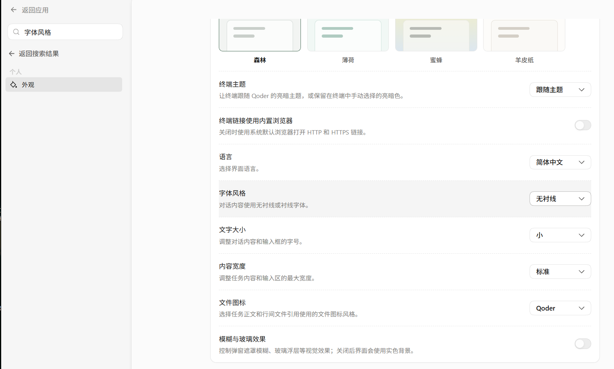

# 设置页搜索实施

本文为待审阅方案，本轮只编写文档，尚未实现搜索。需求依据是用户提供的两张
Qoder 截图与三条交互要求；图中的配置名称用于理解交互，不要求新增同名配置。
本方案在现有设置域内增加搜索、页面导航与配置项定位，沿用现有设置读写链路。
总入口见[全局架构](全局架构.md)，当前事实见[设置页模块](../模块/设置页.md)。

## 1. 目标与截图理解

输入关键词后，左侧呈现匹配的设置页及其所属大分组，右侧呈现具体搜索结果。
用户可以先浏览完整设置页，也可以直接定位某个配置项，两种入口都保留搜索上下文。

| 层级 | Qoder 截图中的例子 | Cogent 对应 |
| --- | --- | --- |
| 大分组 | 个人 | 基础设置、Agent 能力；保留现有名称与次序 |
| 设置页，即用户所说的小区块 | 外观 | 常规、外观、通知、MCP 服务器等左侧导航项 |
| 具体配置项 | 字体风格 | 内容字体、代码字体、界面字号等右侧设置行 |

第一张图：搜索框保留“字体风格”；左侧只留下命中的“外观”，上方仍显示“个人”；
右侧是“搜索结果”、数量、配置项名称、所属页和“打开”。


第二张图：进入的是完整外观页，相邻配置项仍在；目标“字体风格”已滚动到可见处，
整行铺淡色背景；左侧仍保留搜索词、过滤后的导航及“返回搜索结果”。



必须满足的三个行为：

1. 左侧按搜索结果过滤设置页，命中页所属的大分组显示在它们上方；空分组隐藏。
2. 点击左侧设置页，右侧打开该页的完整详情，按普通切页语义从顶部浏览。
3. 点击右侧结果的“打开”，进入所属页，定位到具体配置项并高亮整行背景。

保留搜索词和“返回搜索结果”来自截图。以下关于高亮时长、排序、清空和键盘操作
的约定是本方案建议，不宣称已从截图确认 Qoder 的实际行为。

## 2. 当前实现与接入点

下列路径均相对项目根；行号对应本次实读位置。

| 已确认事实 | 出处 | 实施影响 |
| --- | --- | --- |
| 侧栏已有搜索输入，但没有受控值或事件，始终渲染全部分组 | `src/renderer/src/features/settings/SettingsSidebar.tsx:28–66` | 接搜索状态与过滤投影，沿用现有侧栏结构 |
| 两个大分组和全部设置页来自静态注册表 | `src/renderer/src/features/settings/data.ts:26–59` | 分组、名称、图标和次序继续从这里读取 |
| 设置 store 目前只保存选中分区 | `src/renderer/src/stores/settings.ts:25–33` | 搜索词、结果/详情视图与定位请求归同一设置域 owner |
| 主体按分区挂载，切分区的布局 Effect 无条件回顶 | `src/renderer/src/features/settings/SettingsMain.tsx:22–55` | 搜索定位须与回顶协调，不能先定位又被回顶覆盖 |
| 详情骨架、组卡和设置行已有通用件 | `src/renderer/src/features/settings/SettingsParts.tsx:20–115` | 结果页复用骨架；定位锚点和背景状态集中在通用件 |
| 主题色使用自绘块，未走 SettingsRow；存储首访先显示统计占位 | `src/renderer/src/features/settings/AppearanceSection.tsx:170–176`；`StorageSection.tsx:49–57`（同目录） | 自绘块也接定位容器；异步配置行实际挂载后再消费定位 |
| 通知页的系统设置入口在 Linux 不渲染 | `src/renderer/src/features/settings/NotificationsSection.tsx:91,163–188` | 搜索索引与原页面共用可见性条件 |
| 附件分析三行只在 MCP 用户作用域、列表读取完成后挂载 | `src/renderer/src/features/settings/McpSection.tsx:278`；`MediaBindingsSection.tsx:14,53–61`（同目录） | 结果注明“本机 · 用户”，打开时先建立该浏览作用域再定位 |
| 首页模型菜单会直接调用 setSection('models') | `src/renderer/src/features/home/ModelMenu.tsx:162–166` | 外部明确导航必须能退出旧搜索上下文，不能被结果页挡住 |
| 设置侧栏也受窗口 ≤760px 自动收起及用户手动折叠影响 | `src/renderer/src/features/shell/AppShell.tsx:47–49,70–72,107` | 折叠时在主内容提供同源搜索入口，不能只验宽屏侧栏 |

## 3. 交互约定

### 3.1 搜索、浏览与返回

| 操作 | 左侧 | 右侧与定位 |
| --- | --- | --- |
| 搜索为空或只有空白 | 完整分组导航 | 显示当前设置页，无搜索高亮 |
| 输入非空关键词 | 显示命中页及所属大分组；同页多个命中只显示一个导航项 | 切到结果页，实时更新结果与数量 |
| 点击左侧命中页 | 保留搜索词和过滤导航，显示“返回搜索结果” | 打开完整设置页，回顶，不自动选择某条配置项 |
| 点击配置项结果的“打开” | 保留搜索词和过滤导航，选中所属页，显示返回入口 | 打开完整设置页，目标挂载后定位、聚焦行容器、铺背景 |
| 点击页面级结果的“打开” | 同上 | 打开该页顶部；页面结果明确标注“设置页” |
| 点击“返回搜索结果” | 保留搜索词与过滤导航 | 恢复同一查询的结果列表和列表滚动位置，清除目标背景 |
| 在详情中修改搜索词 | 立即重算匹配页 | 返回新的结果页，清除旧定位，结果列表回顶 |
| 清空搜索或删除到只剩空白 | 恢复完整导航，隐藏返回入口 | 保留最近打开的设置页；若正在该页，不额外重挂载或回顶；清除背景 |
| 从首页“管理模型”等入口明确跳转 | 恢复完整导航、清空旧搜索 | 打开指定设置页，沿用正常导航语义 |

输入搜索本身不改选中分区，只有点击页入口或结果才改变分区。结果态的左侧条目
只表示匹配页；只有右侧正在显示详情时，才用 `aria-current` 表示当前页。
大分组继续是说明标题，不变成可点击结果，也不把配置行塞进左侧生成第三层导航。

搜索框显示清空按钮并提供“搜索设置”的可访问名称。输入即筛选，无需点搜索按钮。
输入法组合期间不拦截 Enter / Escape；搜索框内 Escape 清空非空查询，空查询不触发
页面退出。导航、返回和“打开”均可通过 Tab 与原生按钮键盘操作完成；返回结果时，
键盘焦点回到刚打开的结果按钮；目标因查询变化消失时，焦点留在搜索输入。

无匹配时，左侧隐藏空分组并显示“没有匹配的设置页”；右侧显示“没有找到与
‘关键词’相关的设置”和清空入口。加载不是无匹配：搜索目录本地同步可用，具体
详情页的数据加载及失败仍由原页面呈现。

侧栏可见时沿用截图的左右结构。侧栏折叠时，主内容顶部显示同一套搜索框与返回
入口；两处复用搜索组件和共享状态，只让可见入口参与焦点顺序。折叠状态直接由
AppShell 已求出的 sidebarCollapsed 传给 SettingsMain，不在设置页另算一份断点。
窗口放宽或展开侧栏后回到侧栏入口，保留查询和当前结果/详情视图。

### 3.2 搜索结果

右侧复用 `SettingsPage`：标题“搜索结果”，说明分别统计“匹配的设置”和“相关设置页”。
配置项结果包含真实名称、所属路径、必要的匹配说明及右侧“打开”按钮。
路径示例：`基础设置 › 外观 › 对话`；同名配置项通过完整路径区分。
页面级结果单独成组，避免把一个页面入口算作一项配置。

按关键词高亮结果中实际匹配的文字；这是文字标记，与进入详情后的整行背景不同。
只通过别名匹配时展示“匹配关键词：…”等说明，不改写真实配置项名称。
例如 Qoder 的“字体风格”在 Cogent 可作为“内容字体”的检索别名，实际结果仍叫“内容字体”。

### 3.3 定位与背景

“打开”只做导航、滚动与聚焦，不自动操作开关、不展开选择器或字体弹窗、不触发保存。
详情展示全部原有设置，保留上下文；默认让目标行位于内容视口中部，页首或页尾由正常
滚动边界约束；高于视口的块从顶部开始可见。只滚动所属设置内容容器，不滚动应用外壳。

背景覆盖目标行的说明与控件区域，使用明暗主题都可辨认的语义淡色底，不改变行高、
边框或控件皮肤。主题色等非标准行也使用同一个定位容器。

建议高亮保留到返回结果、另选页面/配置项、改变/清空查询或离开该作用域；不设置
自动消失计时。截图不能证明高亮生命周期，此处选择持续提示，便于找到后继续修改。
用户手动滚动不反复拉回，修改该项也不重新定位。再次打开同一项产生新导航请求，
重新滚动和聚焦；旧异步完成不能抢走新目标的焦点或恢复旧背景。

## 4. 搜索目录与匹配

### 4.1 覆盖范围

一次交付覆盖已有设置页入口及可唯一定位的固定设置行。

| 区域 | 搜索目录与目标 |
| --- | --- |
| 常规 | 默认权限、自动生成会话名称、输出详细程度、显示过程请求详情、耗时显示格式、发送快捷键、关闭窗口时、Chrome 硬件加速 |
| 外观 | 深色浅色、主题色、界面字号、强调色、内容字体、代码字体、代码字体大小、Markdown 主题、显示代码行号、长行自动换行 |
| 通知 | 轮次完成通知、权限请求通知、等待回答通知、系统通知、播放提示音、系统通知设置、音量、音调、三类声音源；平台条件与原页面一致 |
| 存储 | 空间占用、占用明细、应用数据文件夹；明细命中时只定位折叠触发区域，由用户选择是否展开 |
| MCP 服务器 | 页面入口，以及本机用户作用域下的图片分析、视频分析、文档视觉分析三行；目标是“配置”按钮所在行，不直接打开编辑弹窗 |
| 模型设置、技能、归档 | 提供页面入口及准确的检索别名，如供应商、API Key、Base URL、已归档的聊天；页面结果不冒充具体字段结果 |

模型的 API Key / Base URL 等字段隶属具体供应商，单搜字段名不能唯一决定要编辑
哪个对象。此类查询先给“模型设置”页入口；用户选择供应商后使用原详情。MCP、技能
和归档中的用户资源名称、正文仍由各页自己的搜索负责，全局查询不覆盖或回填局部查询。
后续若要直接定位某个资源，须携带其对象身份与作用域，不用第一个对象冒充命中。

尚未实现的分区仍按现有普通导航显示占位，但不生成可配置的搜索结果。真实原因是
尚无设置内容可打开；对应实现落地时一起登记。配置值、密钥、路径值和资源正文
不进入目录，避免搜索读取或展示用户配置数据；目录只保存配置定义与入口元数据。

禁用但可见的行仍可命中，例如读取期间禁用的“自动生成会话名称”开关。尚在读取数据的行可
被找到，打开后等待它实际挂载；现有读取失败要呈现原因，不能把定位未完成报告为成功。
平台隐藏的行不命中；MCP 的用户级固定行使用显式用户级路径和导航上下文，不要求
用户恰好先把该页切到用户作用域。

### 4.2 目录与查询规则

新增设置域内静态目录：每项含稳定 `id`、`section`、组内路径、标题、纯文本说明、
别名、显示顺序和必要的可见性/导航上下文。页名称、图标、大分组从 `data.ts` 读取。
标题与静态说明由配置行和索引共同消费，避免维护两套文案；动态错误、文件名及
当前值不参与搜索，说明可在页面组合为 ReactNode，目录保留其固定语义文本。

匹配采用 NFKC 归一化、忽略英文大小写、首尾空白及多余空格，中文连续子串可命中。
多个空格分隔的关键词要求全部命中同一项的标题、别名、说明或路径，支持“外观 字体”
这样的组合；单关键词也能找到一、两个汉字。不把输入直接当正则表达式。

排序按标题命中、别名命中、说明命中的优先级，路径用于组合词约束；同级结果按原
分组、页面和行顺序稳定排列。查询只命中分组/页面路径时返回页面入口，不把它的所有
配置行扩充为命中。去重按稳定 id，不按显示名称；左侧以所有结果的 section 集合过滤。
页面入口与配置项可同时命中，但分组呈现、分别计数。

目录规模小，直接在内存同步匹配，不做网络请求、磁盘扫描或为搜索预挂所有详情页。
不新增搜索依赖；本功能不依赖正在另案实施的会话搜索服务或数据库索引。

## 5. 状态归属与导航顺序

### 5.1 单一 owner

`stores/settings.ts` 拥有共享导航状态：现有 section、query、内容视图（结果/详情）、
当前定位请求，以及返回结果所需的滚动位置和来源结果 id。定位请求带唯一轮次、
配置项 id、必要的用户作用域上下文和是否已消费的状态。
匹配结果、过滤导航和数量由同一纯函数派生，不另存三份可变列表。

这些是 renderer 内存里的导航状态，无配置语义 owner 或配置单写者变更，不新增
settings.json、localStorage 或 Host 配置字段。离开设置再回来可保留查询与视图；
重启应用不恢复搜索。已消费请求不因组件重挂载自动重新滚动。
通用表单、局部筛选和页面实例的完整保活仍按[页面切换状态保留](页面切换状态保留.md)
处理，本批不依赖该计划先完成。

操作区分“普通导航”“搜索中浏览页面”“打开结果”“返回结果”“改词/清空”：
现有 `setSection` 保留明确普通导航用途，退出旧搜索；侧栏的搜索结果导航走保留
query 的动作。状态应在一次 action 内提交，避免先切页、后补目标产生中间帧。
store 不反向依赖 features，标识及导航状态类型留在设置状态/纯类型层。

```text
query → 本地搜索纯函数 → 结果列表 / 数量 / 分组导航
                              |
        左侧页入口 ────────────┤
                              ▼
                     设置 store 原子提交
                     /                  \
             浏览完整页              打开配置项
                 |                 分区 + 目标轮次
             普通回顶                    |
                                 应用目标浏览作用域
                                        |
                             目标分区/异步行实际挂载
                                        |
                               核对当前目标轮次
                                        |
                         滚动 / 聚焦行容器 / 记录已消费
                                        |
                             背景由当前目标持续投影
```

### 5.2 接线边界

- `SettingsMain` 统一决定滚动策略：新查询的结果回顶，返回结果恢复列表位置，普通
  页面导航回顶，精确目标交给行挂载消费。清空查询留在当前详情时保留当前滚动。
  移除原先仅依赖 section 的无条件回顶，避免与定位争夺最终位置。
- `SettingsRow` 接稳定 searchId，内部共用定位 hook；自绘块用可复用的目标容器，
  两者共用注册与背景逻辑。由真实 ref 挂载/Effect 触发，不查文字、不用固定延时、
  DOM 轮询或 MutationObserver 猜测“已经加载”。
- 目标只在当前请求仍匹配且尚未消费时滚动；普通重渲染、数据回显、用户改值不重复
  触发。旧分区卸载后，旧数据返回也不能消费新的导航请求。
- MCP 用户级配置结果先应用 user 浏览作用域，再按原逻辑读取列表和挂载配置行；
  不能先按活跃项目加载并消费目标。用户手动切作用域时取消旧定位，不强制切回。
- 焦点落到带 `tabIndex=-1` 的行容器，随后 Tab 可操作控件。保存和生效继续走原
  分区处理；不开启新的全局键盘监听或设置写入通道。
  无配置编辑时，搜索和定位不产生保存；用户此前已经编辑的字段仍沿用其原有
  失焦保存语义，不由搜索额外提交或回滚草稿。

## 6. 本次源码对照与采用范围

只对下列本次实读内容作结论，不把某个设置壳未呈现搜索外推为整个仓库没有搜索。
交互形态以用户 Qoder 截图为准；参照仓用于判断索引与定位如何接入。

| 来源与实读出处 | 可确认的机制 | Cogent 采用或调整 |
| --- | --- | --- |
| pi：`reference/pi/packages/coding-agent/src/modes/interactive/components/settings-submenu.ts:68–76,110–135`；`settings-selector.ts:999`（同目录） | TUI 设置列表提供输入搜索；子菜单对标题和说明做本地 fuzzyFilter，选择走原回调 | 借鉴定义可搜、保留原操作回调；TUI 机制不能提供本需求的左右页与 DOM 定位 |
| deepseek-harness：`reference/deepseek-harness/packages/client/ui-settings-general/src/client/SettingsRoot.tsx:47–60,79–110,126` | 设置壳消费有 owner 的 activeId，导航行与活动设置内容分工；该组件未呈现本需求的搜索结果态 | 延续设置域单一导航 owner 和按需挂详情；不因此引入其 slot / modal 壳 |
| zcode：`reference/zcode/packages/ui/src/settings-search/settingsSearchIndex.ts:13–25`；`SettingsSearch.tsx:50–104`（同目录） | 固定元数据与分类入口构成索引，按可见性筛选，名称匹配优先于说明 | 采用固定定义与可见性投影；结果页与侧栏布局按 Qoder，不照搬其搜索 Dialog |
| zcode：`reference/zcode/packages/ui/src/settings-search/SettingsSearchTarget.tsx:4–21`；`reference/zcode/packages/ui/src/settings/SettingsPageParts.tsx:110–135`；`reference/zcode/packages/ui/src/SettingsPage.tsx:710–725` | 稳定 id 标记行；目标行实际挂载后滚动、聚焦；新目标对象区分重复导航，普通导航清目标；高亮约两秒到期 | 采用稳定锚点、挂载后消费与导航轮次；本方案背景持续至退出目标，不照搬两秒计时 |

## 7. 实施批次与文件分工

| 批次 | 主要文件与职责 | 本批完成条件 |
| --- | --- | --- |
| 1. 目录与状态 | 新增 `features/settings/search/` 下的目录、匹配纯函数；扩展 `stores/settings.ts` 的搜索导航动作 | 覆盖表内固定行与页面入口；排序、计数、过滤和状态迁移的行为测试通过 |
| 2. 搜索界面 | 修改 `SettingsSidebar.tsx`、`SettingsMain.tsx`；`features/shell/AppShell.tsx` 透传侧栏折叠态；提取共用搜索组件并新增结果组件，复用 SettingsPage / SettingsGroup 与现有 Button、Input 组件 | 搜索、左侧浏览、右侧打开、返回、清空、空结果及折叠侧栏入口完整走通；平台隐藏项不出现 |
| 3. 精确定位 | 扩展 `SettingsParts.tsx`；在常规/外观/通知/存储/MCP 的固定行登记 id；自绘块接共用目标容器，`McpSection.tsx` / `MediaBindingsSection.tsx` 接用户级导航上下文 | 同页/跨页/异步行/重复打开都能定位；焦点、滚动和背景正确，搜索本身无配置写入 |
| 4. 验证与文档 | 增补设置域行为测试、设置页手测册和事实文档，写对应技术笔记 | 自动检查通过；实机证据与未测范围明确记录；三条需求均可复核 |

表中缩写的实现路径位于 `src/renderer/src/` 对应目录。搜索目录、匹配、结果呈现和
定位分别承担职责，不把所有逻辑堆在 SettingsSidebar 或 SettingsMain。
控件使用现有 shadcn Nova 形态；字号、边距、圆角及明暗颜色遵守[UI布局](../UI布局.md)，
高亮在设置行/目标容器本体实现，不在调用点覆写控件皮肤。

实施后同步：

- [设置页模块](../模块/设置页.md)：目录范围、导航 owner、定位顺序及“验收：”句。
- [UI布局](../UI布局.md#设置页与通用组件)：搜索结果布局、返回入口、文字标记和整行背景配方。
- [设置页手测册](../测试用例/设置页.md)：迁入下面的交互场景，维护真实测试结果。
- 新建 `docs/技术笔记/设置页搜索.md` 并登记[技术笔记索引](../技术笔记/索引.md)：说明
  搜索定义、导航轮次、异步挂载定位与上表参照的异同。
- 完成后按[文档纪律](../约定.md#4-文档纪律写任何-docs-文档前)迁移现状与原理、
  更新全局入口并移除本过程稿。审批或仅写方案不把未来能力写进事实文档。

## 8. 验收

### 8.1 自动回归

新增设置搜索的纯函数、store 与组件行为测试，放在 `tests/renderer/` 对应层：

- 中文单字/短词、英文大小写、全角/空白、组合词、别名、说明、同名项、字面特殊字符；
  排序稳定，同页导航去重，页面与配置项计数分开，空分组隐藏，平台条件一致。
- 搜索→结果→左侧浏览→返回；结果“打开”→正确分区/稳定 id；清空时保留最近详情；
  外部 `setSection('models')` 退出旧搜索，详情改词生成新结果。
- 同页和跨页的滚动策略，重复打开同一项，返回结果恢复位置与焦点；输入法组合期间
  Enter / Escape 不导航或清词，按钮可通过键盘打开。
- 用可控 Promise 让存储或 MCP 行延后挂载；目标出现后才消费；快速更换目标与
  卸载后旧请求完成不能抢焦点。MCP 从项目上下文打开用户级固定项也能定位。
- 未编辑配置时，搜索、浏览、定位及聚焦不触发设置保存；禁用行仍可定位，失败状态如实显示；
  清空/返回/换页/换作用域后背景移除，手动滚动与改值不重复拉回。

测试钉行为，不用“目录里存在某字段”的扫描代替导航、异步和无写入验证。
实施交付运行 `npm run lint`、`npm run typecheck`、`npm run build`、`npm test` 并看完整
输出；本轮文档工作不把这些未来检查记为已通过。

### 8.2 实际界面

1. 搜“内容字体”：左侧只显示“基础设置 → 外观”；右侧出现真实配置项及“打开”。
   搜“字体”时多个配置项可见，左侧“外观”仍只一条。
2. 点击左侧“外观”：显示完整外观页、从顶部浏览，保留搜索词和返回入口，不自动
   打开字体弹窗。返回后点击右侧“内容字体 → 打开”：定位并高亮整行，邻项仍可见。
3. 手动滚到别处，返回结果，再次打开同一项：重新定位。改值正常保存；点击浏览
   入口、返回、清空或改词，旧高亮清除，页面不会被旧请求重新拉走。
4. 搜“通知”，确认通知配置结果与“基础设置 → 通知”关系；用能跨页命中的关键词
   确认多个页面与分组都正确保留。无匹配时检查左右空态，清空后恢复完整导航。
5. 从项目会话进入设置，搜“图片分析”，打开注明“本机 · 用户”的 MCP 配置行；
   冷缓存加载后仍定位正确，不替用户打开“配置”弹窗或写入绑定。
6. 检查存储首访延迟、详情加载失败、读取期间禁用的自动名称开关、Linux 隐藏系统通知设置；
   都不能出现“搜得到但实际打开的是另一项”的假定位。
7. 明暗主题、界面字号端点、100% / 125% / 150% 缩放下检查文字标记、整行背景、
   焦点与按钮；400px 窗口及侧栏折叠时，主内容顶部提供同源搜索/返回入口，能完成
   搜索、打开、返回、清空，结果标题/路径换行且“打开”可达，不要求先展开侧栏。

浏览器或 jsdom 只证明其覆盖到的行为；Electron 实际滚动、焦点、缩放与视觉效果
须单独记录。不得把本方案、自动检查或局部截图写成完整界面验收已通过。
